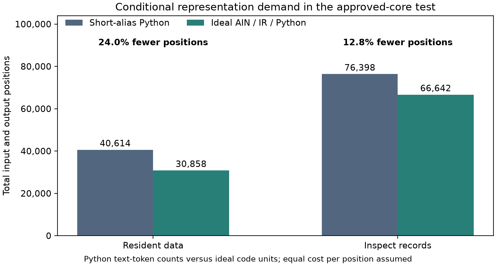
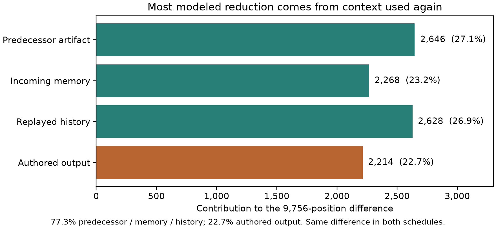
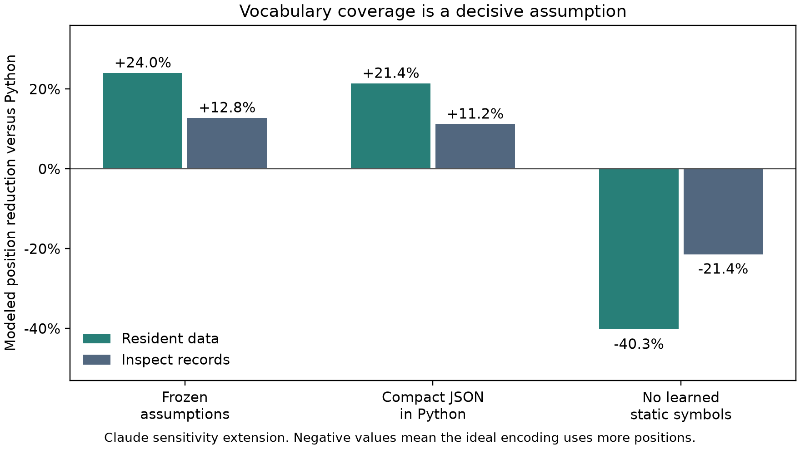

# AIN: A Native Language for More Efficient AI

## A reproducible test of compact learned agent workflows

Izik Bachar · Research draft 10 · 6 November 2026 · Grok results pending

### It started with a beep

I have spent more than 25 years developing software. The idea came from watching R2D2 beep and plips to other machines and made me realize that communication between machine doesn't need to be set of words a beep can be an entire sentence.

That observation led me to a question about the software we ask AI agents to
produce. Human-readable code carries executable meaning, but it also carries
presentation: names, familiar syntax and a structure that people can inspect.
Could an agent learn a computational representation in advance, use it directly
throughout its work, and generate a readable view only when someone needs one?

I call the proposed language AIN, for AI Native Language. The intended agent
would use learned operations and explicit operands across programs, working
records, memory and tool interactions. New task requirements would still need
to be communicated. Established language knowledge would already be available
before evaluation, rather than being retaught through a manual in every prompt.

The latest approved-core test puts numbers on one part of this idea. Under its
declared assumptions, the compact interface requires **24.0% fewer counted total
positions** than short-alias Python when business data remains behind a host
handle, and **12.8% fewer** when records enter context. Separate Codex and Claude
reconstructions reproduce the same integer ledgers. Grok's result is pending.

These are conditional representation results. The test executes the workflows
and their checks, but grants fluent language knowledge and correct composition.
It does not train an AIN agent or measure inference time, electricity or invoices.
Its contribution is a reproducible estimate of the opportunity that a trained
agent experiment would need to realize. [1–4]

### What the approved-core test assumes

The study asks a focused question: given an already learned optimized
representation and approved reusable components, how much context and output
could be avoided while composing, changing, repairing and handing off work?
The fixed premises are fluent representation, an approved core and a perfect
composer. Correct action sequences are supplied. That last premise separates
the cost of expressing correct work from the difficulty of discovering it.

Every condition receives the same capabilities. AICC, the AI Computational
Commons, is my companion proposal for governed discovery and reuse of established
computation. Here, reusable code is equally available to the Python and ideal
conditions. The comparison therefore does not award AIN an exclusive library
or count shared functions as an AICC-specific saving.

The implemented suite covers event filtering and aggregation, cache version and
expiry resolution, and deterministic publication and retry simulation. Each
domain has six parameter and data variants, giving 18 chains. Each chain has
four stages: build, change, repair and handoff. Every artifact composes five
generic approved functions. The common core contains ten public functions,
four explicit `for` loops, one `while` loop and seven comprehensions. Its stored
source measures 603 text tokens with the pinned tokenizer. [1]

Those bodies run real filtering, grouping and retry logic, but the trial
artifacts compose existing components. New algorithms and arbitrary new control
flow are outside this experiment's authoring task. Publication effects are
deterministic simulations. This boundary matters when deciding what to test next.

### From runnable code to learned units

The examples below come from the approved test's saved workflow and executable
core. They connect the language idea to concrete operations, operands and a
change that preserves a functioning program.

The Python view is a whitespace-formatted version of the actual five-operation build artifact. It has the same parsed syntax tree as the frozen one-line renderer; the result table uses the separate short-alias baseline:

```python
lambda r: group_sum(
    filter_lt(
        filter_gte(
            dedupe_by(filter_eq(r, 'kind', 'event'), 'id'),
            'severity', 2),
        'timestamp', 20),
    'group', 'value')
```

The AIN view below is a verified numeric projection of that semantic pipeline.
Its operation references and ordered operands map back to the saved calls. This
display is an article companion, not a claim that the frozen experiment defined
a complete printable AIN grammar or that an AI emitted these symbols:

```json
[5,
 [1,[0,35],[0,18]],
 [5,[0,31]],
 [2,[0,50],[1,2]],
 [3,[0,57],[1,20]],
 [6,[0,28],[0,59]]]
```

In the approved accounting, an established operation reference costs one ideal
unit. Its arguments are still charged. Approved signatures determine operand
order and types; new values cannot disappear into an unexplained symbol. A later
stage can change the pipeline through a precise patch rather than rewriting
the whole program:

```json
[13,[1,2],[0,1],[0,59],[1,3]]
[13,[1,3],[0,40],[3],[0,27]]
```

The first patch raises minimum severity from 2 to 3. The second repairs the injected timestamp comparison by restoring filter_lt.

The leading 5 is the number of calls. Operation IDs 1, 5, 2, 3 and 6 mean filter_eq, dedupe_by, filter_gte, filter_lt and group_sum; 13 is patch. Values tagged 0 are frozen symbol references, 1 means an exact integer, and 3 means null. Symbol IDs 35, 18, 31, 50, 57, 28 and 59 mean kind, event, id, severity, timestamp, group and value. In the patch records, symbol 1 means arg, 40 means op and 27 means filter_lt. Patch indices are zero-based. These IDs and explicit display tags are only a lossless human-facing projection of the real semantic artifacts; they are not the frozen ideal-unit accounting.

The short call depends on actual code. The following component is extracted from
the same approved core, rather than invented as a decorative language example:

```python
def dedupe_by(rows, field):
    seen = set()
    result = []
    for row in rows:
        identity = row[field]
        if identity not in seen:
            seen.add(identity)
            result.append(row)
    return result
```

Human-friendly labels can be supplied by a renderer or metadata. Descriptive
business names and explanations may require additional inference. Their cost
belongs in a real system's ledger when requested. Short-alias Python is already
a strong control here: ordinary Python does not require long descriptive names.

### Counting the complete workflow

The test counts more than the final program. Each stage supplies three logical
action batches with host observations. The next request includes accumulated
action and observation history, the predecessor artifact and any incoming
memory, as well as shared requirements and parameters. Working records and
outgoing memory are preserved by the executed host actions.

One schedule keeps business records resident behind a data handle. The agent
receives requirements, schema and parameters; the host checks the complete
business results. The inspect schedule additionally exposes records in every
request. Identical business inputs are charged in every representation, so the
comparison does not manufacture a language advantage by concealing data from
one side.

Each schedule has 72 executed stages and 216 logical requests. The two schedules
replay the same tasks, producing 144 semantic stage records. Five representation
profiles and three turns yield 2,160 accounting rows. These rows are deterministic
ledger entries, not 2,160 real AI calls or independent task samples.
The workflow replays use CPU execution. Experimental model inference calls are
zero; the submitted plans were already supplied as correct semantic inputs.

| Data schedule | Short-alias Python input | Python output | Ideal input | Ideal output | Total reduction |
|---|---:|---:|---:|---:|---:|
| Resident data | 34,686 | 5,928 | 27,144 | 3,714 | 24.0213% |
| Inspect records | 70,470 | 5,928 | 62,928 | 3,714 | 12.7700% |



Figure 1. Python columns use measured text-token counts; ideal columns combine
modeled code units with the same common text and framing. Total positions fall
from 40,614 to 30,858 in the resident schedule and from 76,398 to 66,642 in the
inspect schedule. Both reductions equal 9,756 positions. [1, 2]

The Python counts use the pinned Qwen2.5-1.5B tokenizer. The ideal accounting uses
a 65,536-entry vocabulary with typed operands, explicit structure and fifteen-bit
literal payload units. Combining these quantities assumes equal cost per
position. It is an accounting comparison, not a measurement of a particular
model's neural computation.

Ideal AIN, ideal readable IR and an ideal Python interface have identical
counts by construction. All receive the same compact semantic interface. A
benefit shared with IR or Python would still support the broader mechanism of
learned compact representation; it would not establish an extra advantage from
AIN's particular name or spelling.

### Most of the opportunity is in repeated context

The result is especially relevant to a whole-agent workflow because most of the
predicted reduction is repeatedly processed material. In the resident schedule,
2,628 avoided positions come from history, 2,646 from the predecessor artifact,
2,268 from incoming memory and 2,214 from authored output. Common input text
contributes no reduction because it is identical across conditions.



Figure 2. The components sum to the 9,756-position difference. Re-read history,
artifact and memory account for 7,542 positions, about 77%; newly authored
output accounts for about 23%. These shares describe modeled positions, not a
division of financial savings or research value. [4]

A shorter representation can therefore matter more than once. It can be emitted,
stored, handed off and processed again. Conversely, common business information
can dilute the percentage gain: the inspect schedule exposes more common text
while retaining the same absolute encoding difference. A real implementation
must also account for context caching, tool behavior and the actual frequency of
human inspection. Their effects on billing are not measured here.

### Independent agents checking the result

The reference implementation establishes the target accounting. Separate
reconstruction records describe counters written from the public specification
and semantic traces before expected aggregate ledgers were consulted. Codex's
first counter matched, and Claude's first counter matched. Their canonical
ledger and totals hashes agree exactly. [3, 4]

| Comparison item | Codex reconstruction | Claude reconstruction | Grok |
|---|---|---|---|
| Resident reduction | 24.0213% | 24.0213% | ?? |
| Inspect reduction | 12.7700% | 12.7700% | ?? |
| Executed stage records checked | 144/144 | 144/144 | ?? |
| Request-ledger rows matched | 2,160/2,160 | 2,160/2,160 | ?? |
| First accounting result | Exact match | Exact match | ?? |

Grok's question marks mean pending evidence, not zero performance or agreement.
The reference implementation is not an additional independent provider result.
The agents are compared on reconstruction and execution checks, not on speed,
intelligence or measured inference efficiency.

Provenance differences remain visible. Codex reports an exact offline reference
rerun with all six pinned tokenizer assets and 20 passing tests on its earlier
package revision. Claude's exact wrapper stopped at tokenizer acquisition.
Its separately labeled deviation used a hash-verified tokenizer file, passed
21 tests on the later package and matched six reference outputs. Different test
counts reflect version differences; they are not a competitive score.

The records disclose consulted material and preserve local precomparison seals.
Those seals are audit records, not third-party timestamp attestations. Claude
also discloses earlier AIN work in the same conversation. Independent agreement
strengthens confidence in the reproducible arithmetic, while leaving the
experiment's premises and the model-learning question unchanged.

### How sensitive the opportunity is

Claude's separately versioned extension probes assumptions without changing the
frozen result. Rendering Python memory and observations as compact JSON narrows
the reductions to 21.41% resident and 11.20% inspect. This shows that conventional
data formatting deserves a competent baseline, even though it does not remove
the conditional opportunity in these fixtures.



Figure 3. Positive values mean fewer modeled positions than the stated Python
baseline; negative values mean more. The no-static-symbol case is an extreme
ablation, not a prediction for a trained AIN model. [4, 5]

Vocabulary coverage is more consequential. The frozen set contains 63 domain
symbols charged at one unit each. Without that learned set, unknown strings
require type, length and payload units. The ideal encoding then requires 40.26%
more positions than short-alias Python in the resident schedule and 21.40%
more in the inspect schedule. This identifies a requirement for the proposed
system: its learned vocabulary must cover useful future work, rather than
merely the fields of its development examples.

The extension also finds a 1.619-times break-even boundary for the cost of
representation-dependent ideal units while holding common text cost fixed.
This is not the ratio of the total columns and does not measure GPU throughput.
The actual cost ratio remains unknown until a model using the representation is
implemented and instrumented. Training, vocabulary construction and maintenance
also require their own resource accounting.

### The next test is a learned agent

The central question remains whether a complete agent trained for this working
representation can finish unseen tasks with less total computation. A bounded
test can start with matched copies of an accessible model, equivalent tools and
equal learning opportunities. One follows a conventional workflow; another
learns AIN and uses it for observable records, memory, actions and artifacts.
A learned IR and compact-source control help identify which design choice
produces any measured benefit.

The evaluation should charge input processing, all generated output, failed
attempts, checking, repairs, adapters and requested readable projections. It
should compare correctly completed work, retain failures and report training
costs and their amortization separately. An AIN-only visible transcript would
not prove that every hidden neural operation uses symbolic AIN.

The current result supplies a reproducible conditional target, not a percentage
promise. Its three composition templates, supplied plans and fixed vocabulary
leave generalization, new control flow and real model behavior open. The next
study can test whether the modeled headroom survives those demands. [6]

### Reproduction and contribution record

The downloadable agent package preserves the specification, semantic traces,
tokenizer identity, executable core, reference observations and submission
requirements. A new agent should preserve its initial implementation and ledger
before comparing expected totals. If it has already seen this article's figures,
it should disclose that exposure. Extensions belong in separate versions, with
the first result and every failed attempt retained.

Concept, architecture, research direction and article approval belong to Izik
Bachar. Codex prepared the reference implementation and documentation with
collaboration agents. The published Codex and Claude reconstruction records
retain their own authorship and disclosed environments. Claude's reported model
identity is self-reported. Grok will be credited when its submission arrives.

### References and evidence

1. [Approved-core reference report and complete workflow ledger](https://github.com/izikon78/AICC/blob/2b6541a24ef71dcd4390f526042ebf131501fc51/experiments/approved_workflow_theory/results/approved-core-2026-11-06/REPORT.md).
2. [Frozen replication specification and counting boundary](https://github.com/izikon78/AICC/blob/2b6541a24ef71dcd4390f526042ebf131501fc51/experiments/approved_workflow_theory/REPLICATION_SPEC.md).
3. [Codex independent reconstruction and exact-rerun provenance](https://github.com/izikon78/AICC/blob/2b6541a24ef71dcd4390f526042ebf131501fc51/experiments/approved_workflow_theory/validation/codex-independent-2026-11-06/INDEPENDENT_REPORT.md).
4. [Claude independent reconstruction and assumption review](https://github.com/izikon78/AICC/blob/e9a8a5111717a57427fac50605cf5cbe0c86b316/experiments/approved_workflow_theory/validation/claude-opus-5.5-independent-2026-11-06/INDEPENDENT_REPORT.md).
5. [Claude sensitivity extension and raw observations](https://github.com/izikon78/AICC/blob/e9a8a5111717a57427fac50605cf5cbe0c86b316/experiments/approved_workflow_theory/validation/claude-opus-5.5-independent-2026-11-06/extension-v1/sensitivity.json).
6. [Draft protocol for matched native learning](https://github.com/izikon78/AICC/blob/2b6541a24ef71dcd4390f526042ebf131501fc51/docs/ain/TRAINED_NATIVE_PILOT_PROTOCOL.md).
