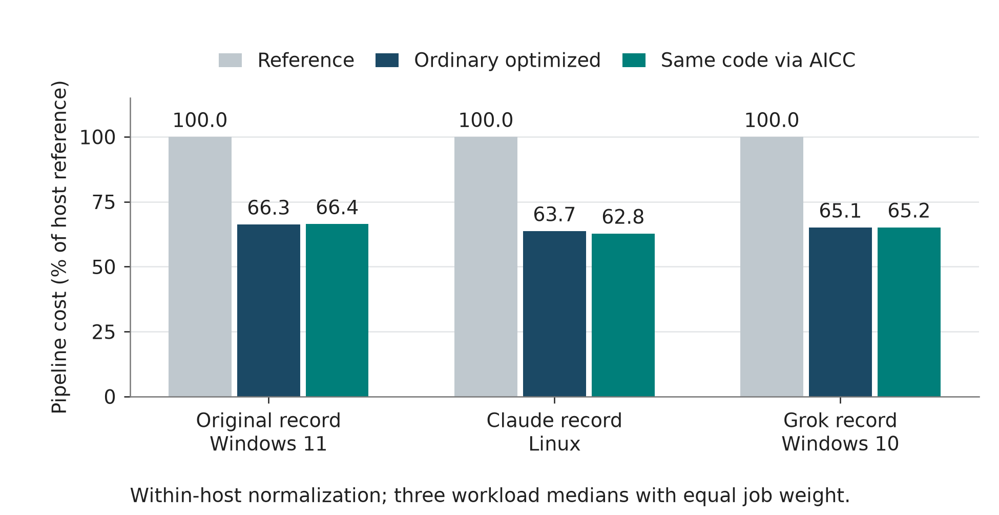
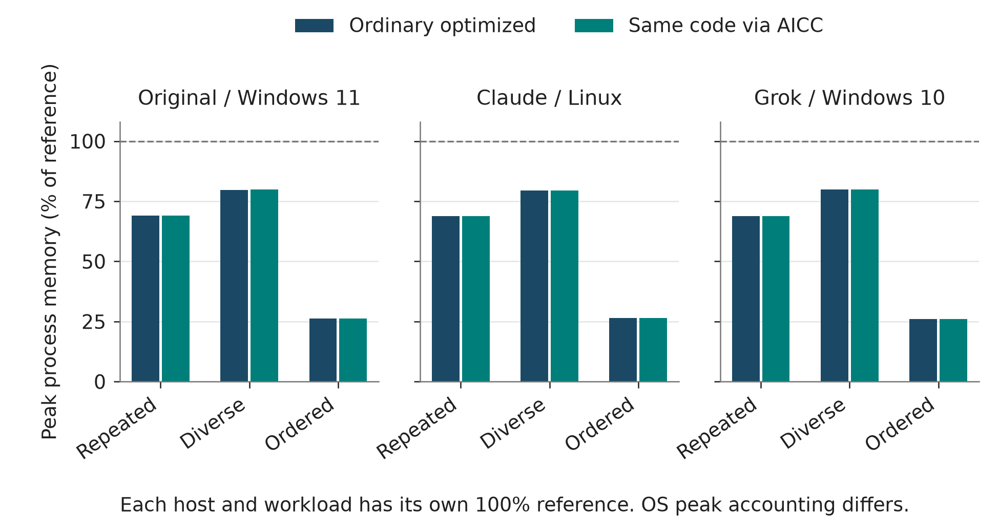
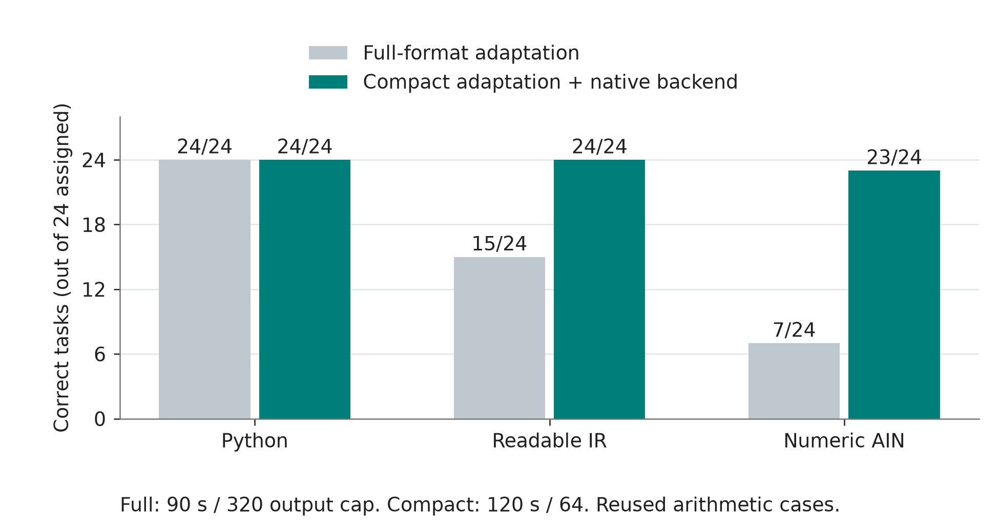
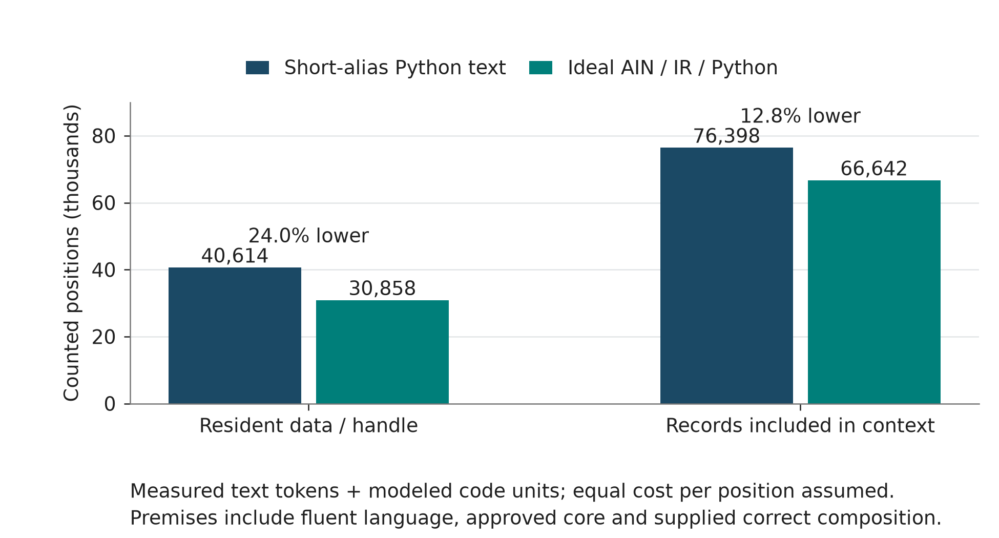

# AIN A Native Language for More Efficient AI

## Language theory and the evidence from agent experiments

Izik Bachar | Research draft 11 | 7 November 2026

## Introduction and theory

### It started with a beep

I have spent more than 25 years developing software. The idea came from watching R2D2 beep and plips to other machines and made me realize that communication between machine doesn't need to be set of words a beep can be an entire sentence.

That observation led me to two questions. Could an AI agent learn a precise computational language designed for its own work? Could it compose established functionality through short references while keeping the implementation and its guarantees available underneath?

I call the proposed language AIN, for AI Native Language. I call the related commons AICC, for AI Computational Commons. AIN concerns the representation an agent uses to author and change computation. AICC concerns discovering, approving, binding and reusing capabilities. Together they suggest a workflow in which an agent works with learned operations, explicit operands, executable records and persistent memory, then produces a human-readable view when requested.

The theory assumes that the language can already be learned and that useful core operations can already be approved. Under that premise, a short instruction can invoke a function containing substantial computation, including loops. New requirements, arguments, private interfaces and business data still have to enter the system. The opportunity is to reduce the repeated expression and processing of established information while preserving correct work.

This draft reviews all fourteen published branch tips available at the review snapshot, together with two saved local adaptation and compiler screens. It preserves the earlier introduction and develops one consistent notation across five language examples. The evidence includes executed programs, processing remeasurements, small model adaptations and a conditional whole-workflow accounting experiment. Each answers a different part of the question. The branch inventory, raw-data checks and detailed review notes accompany the article. [1]

The strongest recurring runtime finding is that optimized flows retain their behavior when used through the prototype's reusable bindings. The most recent theoretical finding is a conditional reduction of about 24% in counted whole-workflow positions against short-alias Python when records remain behind a host handle. Small pretrained-model adaptations also produce unfavorable and incomplete AIN results. The full research question remains whether a fluent learned agent can realize the modeled opportunity on unseen work with lower success-adjusted resources.

## AIN language meaning and strategy

### Learned operations and explicit meaning

A short operation reference derives its usefulness from a stable behavioral contract. The agent would know the fixed language and established operations before evaluation. A compiler or deterministic runtime would enforce types, effects, resource ownership and control flow. The same representation could appear in generated artifacts, working records, tool actions and memory. Requested source projections and explanations would have their own cost.

For this article I use the symbolic style already illustrated in Draft 8. A function is displayed with `@`, an operation call with `!`, a conditional exit with `?`, and a returned value bundle with `^`. Indexed slots identify fields or state. Draft 8's admission example makes the order of computation explicit. It rejects a late event before reserving its identifier, then reserves the first non-late occurrence before severity filtering. Those rules determine whether a later duplicate is suppressed. [2]

| Notation | Meaning in the illustrated view |
|---|---|
| `@50(c) { ... }` | A function with an ordered parameter list |
| `!501(c)` | A reference to a defined operation with explicit arguments |
| `?(condition):^[value]` | A conditional exit carrying its return value |
| `e[2]` | A field or slot reference defined by the contract |
| `^[r]` | A returned value bundle |

The IDs in the following examples belong to their published example catalog. The notation illustrates the theory under the already-available-language premise. The examples' contracts define materialization, ordering and cleanup. Thirteen deterministic mock scenarios check the declared contracts and failure paths. Actual language frontends, model behavior and cross-language runtime performance require their own implementation evidence. [3]

The printed source below explains meaning. The experiment later in the article counts an abstract learned interface with an explicit vocabulary and operand budget. Draft 10 also supplied a lossless numeric JSON display of saved plans. This draft keeps that display in the historical evidence and uses the Draft 8 symbolic style consistently in its explanatory examples.

### C# database access

The SQL Server method opens a connection, executes SELECT * FROM Users and materializes the returned table. Command, reader and connection lifetimes follow the using declarations. [23]

C# source

```csharp
using System.Data;
using System.Threading.Tasks;
using Microsoft.Data.SqlClient;
static async Task<DataTable> ReadUsers(string connectionString) {
    await using var db = new SqlConnection(connectionString);
    await db.OpenAsync();
    await using var command = new SqlCommand("SELECT * FROM Users", db);
    await using var reader = await command.ExecuteReaderAsync();
    var rows = new DataTable();
    rows.Load(reader);
    return rows;
}
```

AIN illustration

```text
@50(c) {
  d=!501(c);
  r=!502(d,"SELECT * FROM Users");
  !503(d);
  ^[r];
}
```

Operations 501, 502 and 503 open the configured database, return materialized query rows and close the connection. Configuration is supplied by the caller and the SQL remains explicit task information.

### Python API request

The Python function fetches a caller-supplied HTTPS JSON endpoint with a network timeout and closes the response through its context manager. [24]

Python source

```python
import json
from urllib.request import urlopen

def fetch_users(url):
    with urlopen(url, timeout=10) as response:
        return json.loads(response.read().decode("utf-8"))
```

AIN illustration

```text
@51(u) {
  h=!511(u,10);
  r=!512(h);
  !513(h);
  ^[r];
}
```

Operations 511, 512 and 513 perform GET, materialize UTF-8 JSON and close the response. The URL and timeout remain explicit operands.

### C++ thread management

The C++20 example starts two approved workers, supplies cooperative stop tokens and joins both. Worker bodies handle their own exceptions. [25]

C++ source

```cpp
#include <thread>
#include <stop_token>
void worker1(std::stop_token, int) noexcept;
void worker2(std::stop_token, int) noexcept;
void run_pair() {
    std::jthread a([](std::stop_token s) { worker1(s, 7); });
    std::jthread b([](std::stop_token s) { worker2(s, 9); });
    a.join();
    b.join();
}
```

AIN illustration

```text
@52() {
  a=!521(1,7);
  b=!521(2,9);
  !523(a);
  !523(b);
  ^[];
}
```

Operation 521 starts a worker by its approved reference and argument. Operation 523 joins its owned handle. Worker references 1 and 2 correspond to the two declared source functions.

### Ruby grouped totals

The Ruby function filters paid orders, accumulates exact integer-cent amounts by customer and returns ascending ASCII customer keys. Negative refund amounts retain their arithmetic meaning. [26]

Ruby source

```ruby
def paid_totals(orders)
  totals = Hash.new(0)
  orders.each do |order|
    next unless order[:paid]
    totals[order[:customer]] += order[:amount_cents]
  end
  totals.sort.to_h
end
```

AIN illustration

```text
@53(o) {
  p=!531(o,"paid");
  t=!532(p,"customer","amount_cents");
  r=!533(t);
  ^[r];
}
```

Operations 531, 532 and 533 select a true boolean field, sum integer amounts by key and order the resulting keys. Field names and input records retain explicit representation.

### Java collection pipeline

For nonnull ASCII email values, the Java stream selects active users, projects email strings, removes duplicates and returns sorted results. This ordering contract is consistent across the displayed implementations. [26]

Java source

```java
import java.util.List;
class UserQueries {
    record User(boolean active, String email) {}
    static List<String> activeEmails(List<User> users) {
        return users.stream().filter(User::active)
            .map(User::email).distinct().sorted().toList();
    }
}
```

AIN illustration

```text
@54(u) {
  a=!541(u,"active");
  e=!542(a,"email");
  d=!543(e);
  r=!544(d);
  ^[r];
}
```

Operations 541, 542, 543 and 544 select the active field, project email, remove duplicate values and sort them. The approved result contract specifies an immutable output sequence.

For the resource examples, the assumed native function scope releases owned database and HTTP handles on failure and requests stop/join cleanup for remaining worker handles. These are the lifetime obligations supplied by using declarations, context managers and jthread in the source views. The example package publishes the full operation contracts and the thirteen deterministic mock scenarios used to inspect them. [3]

### How the strategy becomes an experiment

These examples rely on reusable operations containing familiar database, networking, concurrency and collection behavior. Conventional languages can also call those operations through short names. A fair comparison therefore gives every arm the same implementations and semantic information, then measures the complete work needed to select, compose, change and check them.

A dedicated learned operation vocabulary could reduce representation overhead. A label's character count, its segmentation by a text tokenizer and its cost as an ideal code unit are distinct quantities. The proposed strategy must also handle new control flow and algorithms when the approved core supplies only primitives. Changes to a task's logic continue to carry new information. [4]

## Experiment stages and findings

### Review scope and evidence levels

The review snapshot contains 5,859 experiment/evidence file entries across fourteen branches, representing 796 distinct Git blobs. Shared files on descendant branches represent the same observations. Reviewers read experiment reports, inspected relevant code and recomputed the principal raw aggregates. This review also replays a selected recovered ordering counterexample. Historical model sessions and all large fuzz or million-event jobs were represented by their preserved records. The detailed audit distinguishes reported, replayed, modeled and planned work. [1]

| Stage | Evidence and finding | Scope |
|---|---|---|
| Early syntax and reuse exercises | Language A/B prototypes, Round 7 and Round 8 programs, contract and mutation probes | Exploratory agent work and executable fixtures |
| Runtime and tokenizer diagnostics | Finished-program runtime, binding granularity and saved-source token counts | Implementation and instrumentation measurements |
| Processing study and remeasurements | Three complete 45-worker matrices with matching output signatures | Shared optimized flows on three reported hosts |
| Typed AIN prototypes | Codex register VM and a separate Claude graph implementation | Language/runtime engineering evidence |
| Current-agent controller study | Eighteen correct artifacts, each passing 55 execution cases | Prompted authoring with incomplete AIN usage counters |
| Local learned-format screens | Matched small-model adaptations of full and compact forms | Narrow one-seed adaptation diagnostics |
| Approved-core workflow theory | Executed correct compositions with ideal code-unit accounting and independent counters | Conditional resource-demand estimate |

### Early programs and recovered counterexamples

Round 7 examined ordinary reuse, registry reuse and small controllers. The archived reports describe 14/14 reuse cases, 6/6 controller cases and 3/3 mock binding checks. A later archive audit executed the supplied Claude artifacts and confirmed their listed official-suite behavior. Contributor reports from GPT, Claude, Gemini and Grok preserve different levels of raw evidence and related same-session work. [5]

Round 8 examined workflow composition and contract details. The cross-review branch recovered an earlier Claude attempt that moved from 18/20 to 20/20 after a repair. A later attempt in the same conversation reached 20/20 after probing the ambiguity. Those revisions have separate provenance. Grok's supplied workflow artifacts also passed the twenty-case official suite. Gemini corrected an earlier twenty-four-case description to twenty official workflow cases plus three mock checks. [5, 6]

The recovered branch materially changes the interpretation of an ordering failure. The written contract already required group creation order during a stable timestamp scan. The original bucketed implementation violated that rule, producing 3,127 disagreements in 5,000 generated inputs. A two-event replay during this review reproduces the difference. The older explanation that this particular rule had been omitted should be read with the later correction. [6]

Another historical result reported 14,000 ASCII fuzz agreements across seven functions. An adversarial Unicode comparison of the earlier grouping reimplementation produced 467 agreements in 1,206 cases. Faithful cross-runtime normalization and ordering mattered. These tests demonstrate how a passing small suite can coexist with important semantic defects. [6]

Later contract-based Python and JavaScript with explicit normalization tables each
matched 1,206/1,206 cases. Naive JavaScript defaults matched 559/1,206. The same
Claude conversation authored those alternatives, making their agreement a
contract-and-implementation check within that exploratory record. [6]

Early token and runtime diagnostics were similarly bounded. A symbolic controller measured 29 text tokens against 27 for Python when host-held templates were matched. One Round 8 registry solution measured 713 tokens against 528 for ordinary reuse. A Round 9 CSV contains fifty finished-program harness trials with zero model calls, three historical authoring notes and two unexecuted placeholders. Those records inform tooling and contracts; billed authoring work requires actual model telemetry. [7]

### Processing flows reproduced across hosts

The processing study compares a reference implementation with optimized cached, partitioned and ordered flows, used through ordinary calls or AICC bindings. Codex's original record and the submitted Claude and Grok remeasurements each contain forty-five complete million-event workers. Together they contain 135 completed worker executions and 135 million event visits on the same three public dataset shapes and seeds. Output signatures agree across the retained records. [8-11]

| Reported record | Host | Ordinary pipeline reduction | AICC pipeline reduction |
|---|---|---|---|
| Codex original | Windows 11 | 33.73% | 33.59% |
| Claude remeasurement | Linux | 36.29% | 37.24% |
| Grok remeasurement | Windows 10 | 34.88% | 34.85% |

Each reduction uses an equal-job mixture of the three per-job medians within the recorded host. Absolute seconds across hosts reflect different environments. These records establish that substantial shared optimizations can remain usable through the binding path. Small direction-varying differences between ordinary and AICC paths have limited resolution with three repetitions on non-exclusive hosts.



Figure 1. Lower pipeline cost within each host reflects shared implementation optimization. Reference cost is normalized to 100 for each record. The figure derives from all three retained forty-five-worker matrices and preserves the ordinary-call control. [8-11]

Peak process memory also improved, with ordinary optimized reductions spanning about 20-74% across the workload/host cells. Ordered streaming avoids retaining the full input list in the measured pipeline. Windows working-set and Linux RSS observations describe their respective processes. [8]



Figure 2. Peak process measurements include each process's lifetime high-water behavior. Workloads and repetitions are related cases, and the normalized cells describe within-host changes. The source data retains the absolute MiB medians. [8]

An 867-parameter neural selector learned costs among supplied processing plans. On held-out calibration jobs, learned versus simple-policy kernel sums were about 0.4573 versus 0.4531 seconds in the original record, 0.255129 versus 0.255130 in Claude's record, and 0.200323 versus 0.194538 in Grok's. The selector was slightly worse or practically tied. It selected implementations rather than generating a native language. Feature collection and inference belong in the pipeline ledger. [8]

Granularity was consequential. The original ordinary batch and AICC batch medians were about 0.193 and 0.204 seconds, while split AICC calls totaled about 4.616 seconds in the invocation microbenchmark. Claude and Grok also observed large split-versus-batch differences. A separate cooperative-checkpoint probe showed that batching can delay observing revocation or cancellation. Useful granularity must preserve the required checking boundaries. [8]

### Executable language prototypes and current-agent work

The Codex AIN v0 register VM passed sixty-nine engineering tests. A corrected twenty-seven-worker study matched canonical outputs and effects, and six fresh-context edit cells passed their judges. Numeric AIN execution medians in that Python VM were 22.5-46.5% higher than direct Python on its three processing cases. Those measurements include interpreter and preflight behavior. They establish properties of that implementation and test setup. [12]

Claude's separate operator-graph prototype records forty-seven hand cases, twelve crash cases and four hundred differential traces. A later reassessment found acceptance of same-run records after END, invalid restored state and test scripts with misleading success exits. These findings identify measuring-instrument repairs needed before stronger claims. The two prototypes implement different cores and retain their own evidence. [13]

The later current-agent controller study tested Python, readable IR and numeric AIN across build, change and repair chains. All eighteen scored artifacts passed each of fifty-five named execution cases. The record contains thirty-eight requests, including two empty account-quota rejections with unavailable counters. The AIN all-attempt cost remains an open quantity because those attempts are unmetered. One repair handoff used a labeled fallback after the fault injector confused valid register reuse. Its final program passed. [14]

### Local adaptation and a native compiler screen

Two saved RTX 3080 engineering screens adapted matched copies of Qwen2.5-1.5B. Each arm received ninety-six training examples repeated three times, with one seed, rank-16 LoRA and the existing tokenizer. These are affine arithmetic tasks with reused development and composition cases. The full-format screen required the complete register/type/catalog envelope. The compact screen supplied the same deterministic scaffolding and LLVM backend to every arm. [15, 16]

| Representation | Full-format correct tasks | Compact correct tasks | Compact output tokens | Compact generation seconds |
|---|---|---|---|---|
| Python | 24/24 | 24/24 | 169 | 7.732 |
| Readable IR | 15/24 | 24/24 | 201 | 9.337 |
| Numeric AIN | 7/24 | 23/24 | 201 | 9.164 |

The full-format screen's ninety-second stage cap left some tasks unattempted. Its AIN development score still missed the frozen threshold even if its two development timeouts were granted success. The compact screen used a different output cap, a 120-second stage cap and stronger shared parser constraints. The comparison describes a development change involving representation, constraints and budgets.



Figure 3. The local model observations use one seed and related arithmetic tasks. The two screens use different interfaces and evaluation caps. They provide a diagnostic progression and a within-compact-run control comparison. [15, 16]

The compact compiler emitted and executed native code. All 360 reference programs passed nine input cases each, and equivalent programs from all three forms emitted identical optimized assembly. Full AIN reference targets averaged 102.325 text tokens; compact targets averaged 5.325. Compact readable IR also averaged 5.325, while compact Python averaged 4.525. Predictable scaffolding accounted for the large source reduction. LLVM generated the machine-code expansion through ordinary CPU computation. [16, 27]

These local screens show the feasibility of small adaptation and actual compilation. The user-directed theory question then grants a fluent optimized representation and approved core as premises, allowing a separate examination of complete workflow demand.

### Approved-core whole-workflow theory and agent reconstructions

The approved-core experiment contains eighteen chains across event processing, cache resolution and simulated publication/retry. Each has build, change, repair and fresh-context handoff stages. Every pipeline composes five generic functions. The core contains ten public functions with four explicit for loops, one while loop and seven comprehensions. Build writes a composition, change and repair make one patch, and handoff reuses the saved artifact and memory. All seventy-two stages per schedule execute correctly against the fixture oracles. [17]

The premises grant fluent representation, approved core and perfect composition. A fixed accounting model gives learned references and typed operands explicit costs in a 65,536-entry vocabulary. Fifteen-bit payload units encode new literal information. Python uses measured Qwen text tokens. Common task inputs are charged identically. Combining text tokens and modeled code units assumes equal cost per counted position. There are zero experimental model inference calls in this accounting run. [17]

| Data schedule | Short-alias Python input/output | Ideal input/output | Total reduction |
|---|---|---|---|
| Records behind a host handle | 34,686 / 5,928 | 27,144 / 3,714 | 24.0213% |
| Records included in context | 70,470 / 5,928 | 62,928 / 3,714 | 12.7700% |

Each schedule has 216 logical requests. The two schedules and five representation profiles yield 2,160 deterministic ledger rows. Ideal AIN, ideal readable IR and an ideal Python interface have identical counts under equal encoding opportunities. This demonstrates the conditional mechanism of compact learned composition and repeated-context reuse. Actual inference speed, energy and financial savings require their own conversion and measurement.



Figure 4. The practical columns contain measured Python text tokens plus fixed assumed framing. Ideal columns combine modeled representation units with the same common input and framing. All ideal interfaces tie under equal assumptions. This figure describes conditional position demand. [17]

The resident schedule's difference is 9,756 positions. Reprocessed history, predecessor artifacts and incoming memory account for 7,542, while authored output accounts for 2,214. The same absolute difference produces a smaller percentage when shared business records enter context. That makes the placement and frequency of information central to the whole-agent question.

| Contributor and role | Approved-core reconstruction | Other relevant evidence |
|---|---|---|
| Codex reference implementation | Publishes the target specification and raw ledger | Original processing, controller and local adaptation records |
| Separate Codex counter | First implementation matches all 2,160 rows | Fresh-context reconstruction on the same machine/session |
| Claude submitted counter | First implementation matches all 2,160 rows | Separate processing run and sensitivity extension |
| Grok | Approved-core result pending | Complete earlier forty-five-worker processing submission |
| Gemini | Historical exploratory reports | Corrected Round 8 case count and evidence qualifications |

Codex's independent counter was written from the specification and semantic inputs before reference comparison. Claude's raw first ledger also matches exactly. Claude's exact wrapper stopped during tokenizer acquisition. A separately labeled deviation used a hash-verified tokenizer file, passed its checks and matched the reference outputs. Its provenance and earlier AIN exposure remain disclosed. Precomparison seals record the local review order. Contributor identities and remote execution descriptions retain their reported status. [18, 19]

Claude's sensitivity extension reduces the conditional advantage to 21.41% resident and 11.20% inspect when Python memory and observations use compact JSON. Removing the frozen static-symbol vocabulary makes the modeled ideal representation 40.26% and 21.40% larger, respectively. That extreme ablation exposes the importance of useful vocabulary coverage. The extension's 1.619-times break-even boundary applies to representation-dependent unit cost while common text stays fixed. [20]

## AICC shared library and functionality

AICC proposes a governed way to discover an existing capability, establish that it matches the requested contract, bind it under host authority and reuse it. A useful record would identify behavior, version, artifact, declared dependencies, effects, scope and relevant resource guarantees. Public implementation code can run locally on private data, while private policy stays behind an authorized interface.

For the database example, a shared query capability could specify the driver boundary, row materialization, cancellation, resource release and permissions. A host could validate that capability once for a compatible scope, then issue a binding used by multiple agents and programming languages. A new policy, dependency revision or authority change can require revalidation. This is where AICC's proposed lifecycle benefit would be measured.

The processing prototype already demonstrates this pattern with host-managed bindings. Its Python interface obtains a binding under requested obligations and then calls it as a function. AIN could express the same sequence through learned bind and invoke operations. In either representation the SQL, configuration and authority are explicit inputs. The trusted host remains responsible for enforcing the binding's guarantees. [8]

The following excerpt uses the existing processing prototype. The factory supplies
the registered implementations, and the caller supplies records and parameters.

```python
host = make_runtime()
binding = host.bind("events.cached@1",
    obligations=("exact-event-groups",),
    requirements={"behavior": "events-v1", "input_order": "any"})
result = binding(records, window, minimum)
handoff_record = binding.export_record()
```

A receiving host can restore that record under its current authority and task
requirements. The example package checks a compatible handoff and an incompatible
receiving requirement. This prototype's checks operate inside a trusted process.
Deployment isolation, authentication and complete dependency integrity require
additional mechanisms. [3, 8]

For example, an event-normalization capability and an aggregation capability can be approved separately. An agent composes them for a workflow. Another agent receives the artifact, compatible bindings and persisted state, then changes a threshold or replaces one compatible implementation. Discovery, contract checking, invalidation and any readable review belong in the ledger alongside the short calls.

Operation granularity follows the application's obligations. A batch operation can amortize dispatch across many elements. Cancellation and authority checks may require checkpoints within that batch. The warm-call and fake-clock results above make both sides of that trade-off concrete. Contract tests, versioning and a suitable isolation design must accompany the shared functionality.

## Implementation and future meaning

The present theory test takes optimized language knowledge and approved core as already available. Turning that premise into a learned agent requires a usable executable core, a stable vocabulary and compatible training/evaluation interfaces. The agent must compose new requirements, maintain explicit state and recover from unsuccessful attempts. Existing compiler infrastructure such as LLVM and MLIR provides useful execution backends and intermediate forms for that work. [27, 28]

A next bounded comparison would start from matched accessible models with equal learning opportunities and capabilities. It would train conventional, readable-IR and native-interface agents on complete observable episodes. Evaluation would cover construction, semantic change, interacting-defect repair and handoff on reserved structures. All attempts, checking, repairs, tool interactions, memory traffic and requested human-readable projections would count. Learning costs and repeated-use amortization would have separate ledgers. [21]

The earlier lifecycle proposal describes twenty-seven chains and 135 linked stages. Its configuration remains planned. These proposed lifecycle stages and the completed processing workers belong to different experiments. A lifecycle study would ask whether repeated discovery, approval, revalidation and handoff work becomes cheaper through AICC while comparable ordinary libraries receive the same implementations. [22]

The potential future meaning is broader than shorter printed files. A computational artifact could serve as an agent's editable program, persistent working record and handoff object. Its explicit graph and contracts might help compilers reject invalid effects or resource use earlier. Shorter reusable structures might also reduce repeated context processing. Their practical value depends on task success and total measured work.

Expressing an AI implementation in AIN is a further systems question. Compiler transformations, neural graphs, kernels, memory movement and scheduling determine that execution path. It needs its own comparison alongside the authoring and reuse studies. An agent's visible symbolic records and its hidden neural computation likewise require separate claims and instruments. [4]

## Conclusions

AIN proposes that agents learn a precise computational representation and use it throughout their work. AICC proposes shared, approved and governable capabilities that reduce repeated implementation and compatibility effort. The five examples show how familiar application behavior could be expressed through short learned references while preserving explicit operands and contracts.

The reviewed record supports several bounded findings. Shared code-flow optimizations repeatedly reduce processing time and memory. Prototype languages and bindings execute substantial fixtures, while adversarial cases reveal contract and measuring-instrument gaps. The compact local adaptation screen achieved higher correctness under its changed interface and limits, while its conventional controls remained competitive. The approved-core accounting cases show a conditional whole-workflow opportunity that separate counters reproduce exactly.

The next empirical result should connect those pieces. A learned agent must preserve correctness on new work while reducing the complete resources required to finish it. The current code, raw records, branch audit and reproduction package provide a reviewable foundation for that test.

## References

1. Codex collaboration review, 7 November 2026. All fourteen branch-tip snapshot, deduplicated experiment-file inventory and study audits. [Review package](review/draft11/README.md).
2. Izik Bachar. AICC Article Draft 8 Review, admission example, pages 3-4. [Pinned PDF](https://github.com/izikon78/AICC/blob/4df5ab0f54b2c2951c21e62bc089707bc495646d/docs/article/AICC_Article_Draft_8_Review.pdf).
3. Draft 11 source/AIN examples, operation catalogs, contracts and mock validation. [Example package](examples/draft11/README.md).
4. AIN canonical native hypotheses and primary-source feasibility reassessment. [Hypotheses](../ain/NATIVE_HYPOTHESES.md), [reassessment](../research/NATIVE_AIN_FEASIBILITY_2026-11-05.md).
5. Archive review and official artifact replay, 4 November 2026. [Pinned review](https://github.com/izikon78/AICC/blob/c6eb51028f7172b6a0d4c349fab56be3ecf5ac25/docs/research/REVIEW_2026-11-04.md).
6. Claude cross-review, recovered earlier artifacts and ordering corrections. [Pinned report](https://github.com/izikon78/AICC/blob/4cd023fb78e966d202ace372d4e4bbf9588a5456/agents/claude/cross-review/CROSS_REVIEW_2026-11-04.md).
7. Claude Round 9 efficiency diagnostics and raw instrumentation records. [Pinned report](https://github.com/izikon78/AICC/blob/93c0c175ee3c996ac3b28fee76600e1350e15d23/agents/claude/round9-efficiency/AICC_Efficiency_Research_Report_Claude.md).
8. Processing-study replication synthesis, reviewed 5 November 2026. [Synthesis](../research/REPLICATION_SYNTHESIS_2026-11-05.md).
9. Original Codex processing study, source and forty-five-worker record. [Pinned results](https://github.com/izikon78/AICC/tree/75de32b757b8bdc43886213ee6b9dd9470717918/experiments/processing_study/results/full-2026-11-05).
10. Claude processing remeasurement and retained interrupted attempt. [Pinned report](https://github.com/izikon78/AICC/blob/2f17cd3825f8e9785c919da2add80d1e35e97b97/agents/claude/processing-study-replication-2026-11-05/AGENT_REPORT.md).
11. Grok processing record and imported artifact provenance. [Pinned results](https://github.com/izikon78/AICC/tree/261ed8ee3e870df1ab51a40aeb1e2a9e32f3d549/experiments/processing_study/results/grok-4.7-2026-11-05-trackA-001).
12. Codex AIN v0 first execution, corrected worker run and edit pilot. [Pinned report](https://github.com/izikon78/AICC/blob/dcb47b51245a51a7474949f04c47464d1363d755/experiments/ain_v0/FIRST_EXECUTION_REPORT.md).
13. Claude separate AIN graph prototype and later replay/adversarial evidence. [Prototype](https://github.com/izikon78/AICC/blob/a28436311f152ce65bdb317918c49d75c256bf25/experiments/ain_v0/README.md), [audit evidence](../research/native-reassessment/claude-review-evidence.json).
14. Current-agent controller study overview and all-attempt usage qualifications. [Pinned overview](https://github.com/izikon78/AICC/blob/60ba43bad3588815ecebe1504c35f2dfe7f0e97d/experiments/ain_fluency/RESULTS_OVERVIEW.md).
15. Local full-format adaptation, frozen configuration, predictions and report. [Report](../../experiments/native_learning_gate/results/rtx3080-2026-11-06/REPORT.md).
16. Local compact-source/native compiler test, reference and learned outputs. [Report](../../experiments/ain_compiler_gate/results/rtx3080-2026-11-06-learning-v2/REPORT.md).
17. Approved-core theory reference, specification and complete ledgers. [Pinned report](https://github.com/izikon78/AICC/blob/2b6541a24ef71dcd4390f526042ebf131501fc51/experiments/approved_workflow_theory/results/approved-core-2026-11-06/REPORT.md).
18. Separate Codex reconstruction and exact-rerun provenance. [Pinned report](https://github.com/izikon78/AICC/blob/2b6541a24ef71dcd4390f526042ebf131501fc51/experiments/approved_workflow_theory/validation/codex-independent-2026-11-06/INDEPENDENT_REPORT.md).
19. Claude independent reconstruction, acquisition failure and labeled deviation. [Pinned report](https://github.com/izikon78/AICC/blob/e9a8a5111717a57427fac50605cf5cbe0c86b316/experiments/approved_workflow_theory/validation/claude-opus-5.5-independent-2026-11-06/INDEPENDENT_REPORT.md).
20. Claude separately versioned assumption sensitivity. [Pinned raw results](https://github.com/izikon78/AICC/blob/e9a8a5111717a57427fac50605cf5cbe0c86b316/experiments/approved_workflow_theory/validation/claude-opus-5.5-independent-2026-11-06/extension-v1/sensitivity.json).
21. Draft trained-native whole-agent protocol and proposed measuring criteria. [Protocol](../ain/TRAINED_NATIVE_PILOT_PROTOCOL.md).
22. Planned AICC lifecycle pilot. [Protocol](../../experiments/lifecycle-pilot/PROTOCOL.md).
23. Microsoft Data SqlClient SqlConnection API and disposal examples. [Official documentation](https://learn.microsoft.com/en-us/dotnet/api/microsoft.data.sqlclient.sqlconnection?view=sqlclient-dotnet-standard-5.2).
24. Python 3.12 urllib.request context-managed HTTP interface. [Official documentation](https://docs.python.org/3.12/library/urllib.request.html).
25. C++ working draft, jthread lifetime, stop and join provisions. [Standards draft source](https://github.com/cplusplus/draft/blob/master/source/threads.tex).
26. Ruby Enumerable collection operations and Java Stream pipelines. [Ruby documentation](https://docs.ruby-lang.org/en/3.3/Enumerable.html), [Java documentation](https://docs.oracle.com/en/java/javase/21/docs/api/java.base/java/util/stream/Stream.html).
27. LLVM code-generation architecture. [Official documentation](https://llvm.org/docs/CodeGenerator.html).
28. MLIR lowering and code-generation example. [Official tutorial](https://mlir.llvm.org/docs/Tutorials/Toy/Ch-6/).

## Credits

Concept, architecture, research direction and article approval belong to Izik Bachar. The opening origin paragraph is preserved as requested. Codex prepared the current synthesis, reference code, audits, examples and figures with same-session collaboration agents.

The archived discussions and submissions retain contributions attributed to ChatGPT/OpenAI, Claude/Anthropic, Gemini/Google and Grok/xAI. The original Codex processing record, separate Claude and Grok processing remeasurements, separate language prototypes, and approved-core reconstructions retain their own authorship and provenance. Contributor model identities and remote environments are reported by their submitters. Grok's approved-core reconstruction will receive its result row when its evidence is available.

Independent reconstruction means rebuilding the specified accounting under its stated premises. The shared public specification, earlier conversation exposure and local seals are disclosed in the records. This article is a research draft supported by reproducible artifacts and explicit remaining questions.
