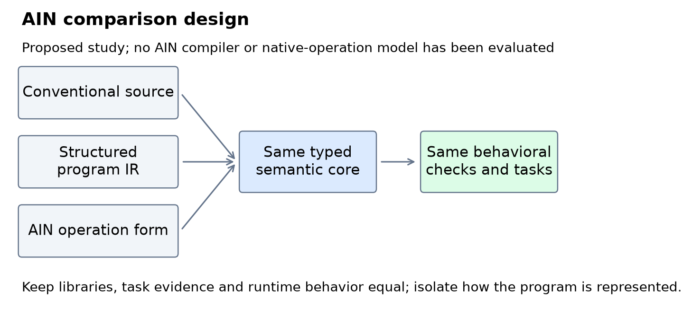
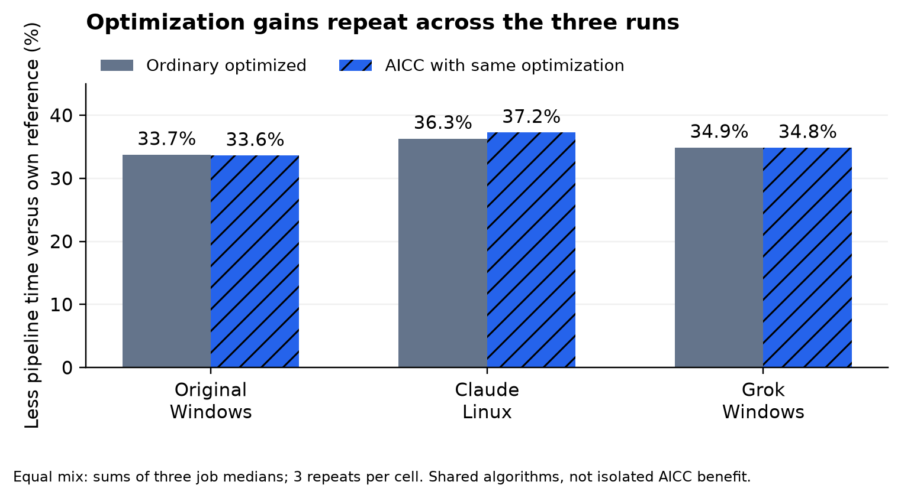
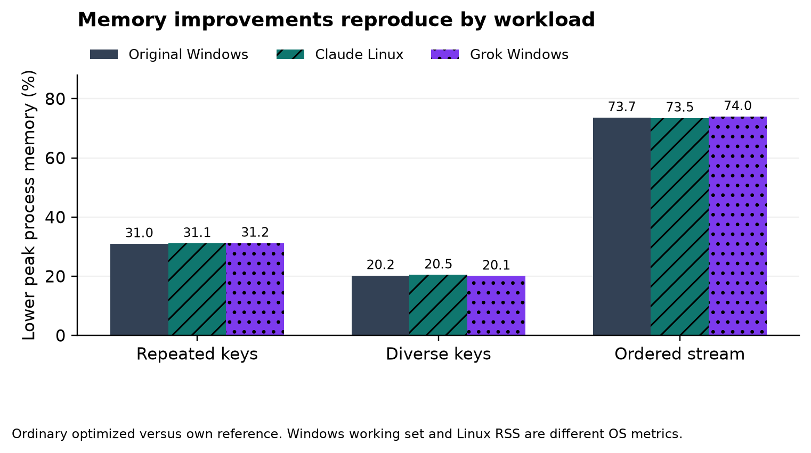
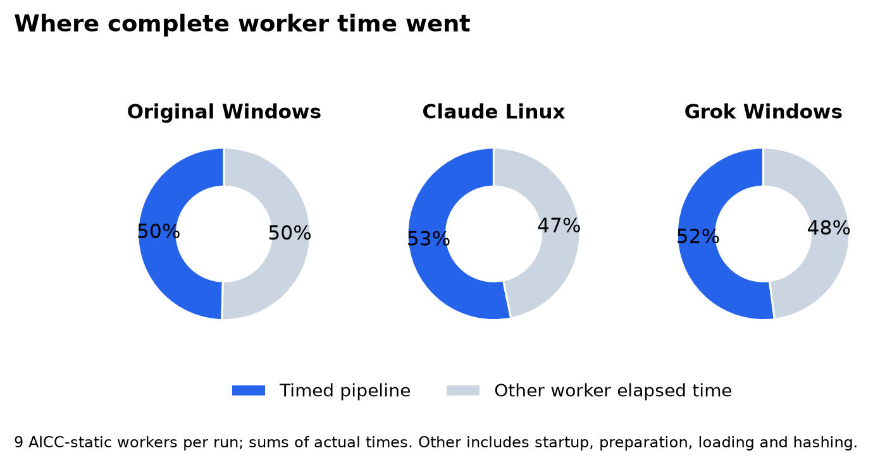
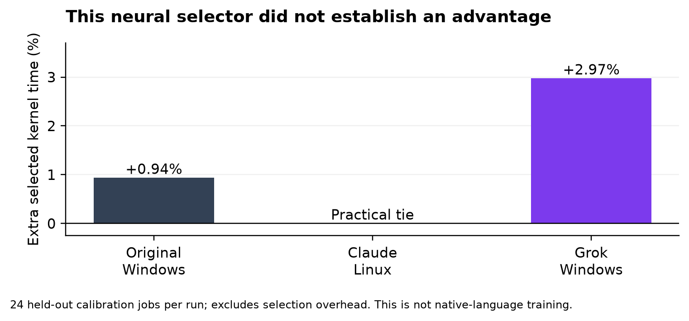

# AIN and AI Native Software

## A research proposal informed by computational reuse experiments

Izik Bachar

Research draft 8 | 5 November 2026 | AIN research direction and reviewed studies

### It started with a beep

I have spent more than 25 years developing software. The idea came from watching R2D2 beep and plips to other machines and made me realize that communication between machine doesn't need to be set of words a beep can be an entire sentence.

That raised two questions for me. Could AI systems author software using a computational representation designed for them? And could they use established functionality without repeatedly reading, explaining, or recreating its implementation?

Those questions lead to two related proposals. One is an AI-native programming representation with precise executable semantics. I am using AIN, for AI Native Language, as its working name. The other is an AI Computational Commons, or AICC: a governed collection of reusable capabilities that agents can discover, bind, and compose. Either idea could prove useful without the other.

The research now includes runnable prototypes, a larger processing study, and two separately submitted remeasurements on Linux and Windows. AI-designed code flows reduced execution time and process memory on the synthetic jobs we tested. Ordinary code could use the same optimizations, however, and the neural selector did not consistently improve on a simple policy. We have not established that AICC reduces total development cost or billed AI usage. The results give us an engineering foundation; my next priority is the language itself. This article explains why that question matters, what the existing measurements contribute, and how AIN should be tested.

### Two ideas that need separate tests

An AI-native representation concerns how a model expresses new computation. It would need operations for arithmetic, branching, repetition, data structures, resource lifetime, and calling other operations. Its meaning would be specified by a language and enforced by a deterministic compiler or runtime. Renaming English keywords or printing fewer characters would not by itself establish a better representation.

AICC concerns which computation an agent needs to author at all. A suitable existing capability might already implement the required behavior. The agent could select it under a precise contract, establish an authorized binding, and compose it with new application logic. A conventional Python or C# program could use such a commons; a new language is optional.

The relevant comparison is competent conventional development. Libraries, package managers, documentation, caching, and existing tools already let agents call functions without reading their bodies. AICC must demonstrate an advantage over that baseline. Repeatedly printing an entire implementation on every call would make an artificially expensive control.

For the language proposal, the eventual experiment must compare equivalent tasks under fair model, training, and tooling conditions. We have not trained a model to generate native operation tokens. A working toy interpreter answers a narrower question: whether a particular small notation can be parsed and executed.

### Why AIN is the next research priority

The question I now want to pursue is whether a model can work more effectively with a program represented as precise computational structure. AIN would need to express new algorithms, state, control flow, resource ownership, effects, and error handling. It must support meaningful changes and repairs, rather than merely invoke a library containing the whole solution.

The possible value is concrete. An agent might make a smaller, more reliable change to an explicit program graph; a compiler might reject an invalid resource use before execution; or another agent might continue from a versioned computational structure without reconstructing its intent from source text. Each possibility needs measurement against competent conventional code and structured-program tools. None follows from replacing words with numbers.

AIN is a working research name within AICC, not a claim of a unique acronym or an already implemented language. AICC remains the capability commons. Keeping the names distinct helps keep the experiments distinct: AIN concerns representation and authoring, while AICC concerns reuse and binding.



Figure 1. Proposed language experiment. All representations must preserve the same required behavior and receive equivalent libraries and semantic information. This diagram describes future work, not an executed AIN result. [13]

### AICC as a reusable execution foundation

A commons capability needs a precise behavioral contract, artifact identity, dependencies, and host-enforced authority. A type signature alone does not say which duplicate wins, how groups are ordered, or whether a call can write a file. Multiple implementations may satisfy one contract, and an agent may improve their internal flows when conformance and required effects remain intact.

A validated binding lets a host retain compatibility evidence and supply a scoped reference to an identified operation. It must account for relevant changes, revocation, expiry, and loaded-code identity. The prototype exercises some of these mechanisms in one trusted Python process; it does not provide production isolation or complete transitive integrity. [2]

Public capabilities can coexist with private domains. Public code can execute locally on private data, while private rules stay behind an authorized interface. Signatures, encryption, authorization, and isolation provide different protections; a symbolic handle supplies none of them on its own.

AIN could use that foundation, but its initial representation experiment should hold library access constant. Conventional source, a typed intermediate representation, and AIN must reach the same implementations. Otherwise a result could merely show that one arm received a better library.

### A complex code problem for AIN

The next task should resemble a system an engineer has to maintain. Consider a transactional event-processing service for industrial equipment. Events arrive out of order. Watermarks determine which event-time prefix is safe to process. The service must deduplicate within a defined retention horizon, normalize grouping fields, form anchored windows, call tenant-private scoring rules with bounded concurrency, and publish ordered reports with a recoverable checkpoint.

That introduces difficult interactions. A low-severity first occurrence must still suppress a later duplicate. A late event must not reserve its ID. A crash after publication but before acknowledgment must not publish the epoch again. Cancellation must stop new work at declared checkpoints without pretending to preempt an already running call. An optimizer must preserve those rules while controlling memory and queue growth.

The proposed configuration uses window 600, lateness 120, dedupe horizon 1,200, eight concurrent scoring calls, and 32 waiting calls. Exact field sizes, state limits, integer behavior, error ordering, and idempotent commit rules are specified in the [complex task contract](https://github.com/izikon78/AICC/blob/research/ain-language-and-study-results/docs/ain/COMPLEX_TASK.md). This is a new specification, not the behavior already measured by the finite-input kernels. No implementation or test result is claimed for it. [13]

#### Admission order that an optimizer must preserve

An illustrative conventional fragment makes one subtle part of the new computation visible:

```python
def admit(event, state, frontier, horizon, limits):
    validate(event)
    if event.timestamp < frontier:
        return LATE
    key = (event.tenant, event.event_id)
    if key in state.seen:
        return DUPLICATE
    reserve_id_bounded(state.seen, key,
                       event.timestamp + horizon, limits.ids)
    event = normalize_grouping_fields(event)
    if event.severity < 1:
        return FILTERED
    push_event_bounded(state.pending, event, limits.events)
    return ACCEPTED
```

This fragment runs within an uncommitted epoch. Its caller has already applied the current watermark's dedupe eviction and checked increasing source offsets. Here event is a decoded log envelope carrying a stable source_offset as well as its payload; pending insertion orders by timestamp and source_offset. The caller records the outcome and commits the complete state only after the epoch succeeds. The bounded primitives fail before insertion on capacity exhaustion, and horizon arithmetic is exact. These interfaces still need implementation and tests.

A possible numeric AIN view of that admission logic is:

```text
@42(e,s,c,h,l) {
  !101(e);
  ?(e[2]<c):^[-1,s];
  k=[e[0],e[1]];
  p=!201(s[0],k);
  ?(p[0]=1):^[-2,s];
  !202(s[0],k,e[2]+h,l[0]);
  e=!204(e);
  ?(e[3]<1):^[-3,s];
  !203(s[1],e,l[1]);
  ^[1,s];
}
```

The human-facing catalog would define event fields 0 through 4 as tenant, ID, timestamp, severity, and stable source offset; state slots 0 and 1 as the retained-ID table and pending-event heap; and limits 0 and 1 as their capacities. Operation 101 validates, 201 performs a presence lookup, 202 reserves an ID, 203 inserts by timestamp and source offset, and 204 normalizes the grouping fields while preserving the offset. The negative return codes label late, duplicate, and filtered outcomes; they are not silent exceptions. The conventional arm receives exactly the same primitives and guarantees.

This sketch has no selected grammar, compiler, or dedicated tokenizer tokens. It is a way to inspect the decision sequence. Filtering before reserving an ID would change the result. Keeping a late ID would also change the result. A language experiment should test whether agents preserve those distinctions when editing, optimizing, and repairing the whole workflow.

#### State and effects belong in the language test

The complete task must also represent buffering under watermarks, resource limits, reverse completion of private scoring calls, deterministic error selection, cooperative cancellation, and atomic publication. A numeric call to a prebuilt whole-workflow implementation would not test authoring those behaviors. The repository includes a larger illustrative graph and its semantic obligations so the eventual evaluator can distinguish composition from newly implemented logic. [13]

One proposed trace reserves ID A from a severity-zero event, rejects a later higher-severity duplicate, then admits out-of-order B and C. A watermark finalizes their anchored group in event-time order. A later late D is discarded without reserving its ID, so D at the exact frontier can still be admitted. Crash/retry, overflow, and cancellation variants must then preserve the defined publication and checkpoint trace. This is an expected trace by inspection, not an executed conformance result.

The potential research value is reliable construction and change of this coupled behavior. A compact notation is useful only if it helps the agent meet the complete contract at acceptable total effort.

### How the research reached this point

The early work was an AI-assisted exploratory exercise. I used ChatGPT, Claude, Gemini, and Grok to challenge the proposal and develop toy tasks and counterexamples. Their reports and submitted programs are research inputs, not peer review or independently blinded trials. Model identities in the historical reports are self-reported. [1]

| Period | Work and evidence status |
|---|---|
| November 2 and 3 | Early discussion and reported Round 7 and Round 8 exercises developed the language and commons proposals. Exact report dates should not be confused with independently verified execution dates. |
| November 4 | The supplied archive was organized and submitted programs were rerun against the official fixtures. Missing artifact versions and unsupported efficiency claims were recorded. |
| November 5 | The larger local processing and neural-selection study was executed. Its code, raw measurements, weights, source hashes, and replication assignment were uploaded for review. |
| November 5 replications | Claude supplied a Linux remeasurement and Grok a second Windows remeasurement. Both used the same public workloads; their raw records and checksums were reviewed for this draft. |
| Pending | Further agents' results and a controlled authoring and lifecycle-cost study. Their outcomes are not included in this draft. |

The November 4 rerun recovered useful narrow evidence. Claude's supplied Round 7 ordinary and registry reuse programs each passed 14 of 14 cases; its Python and symbolic controllers each passed six of six. The supplied Claude and Grok Round 8 programs each passed 20 of 20 official workflow assertions in both the ordinary-library and registry approaches. The mock permission checks passed three of three. Executing those finished programs does not reproduce the effort or model usage involved in authoring them. [1]

Gemini corrected an earlier 24-case claim to 20 official workflow cases plus three mock checks. Some passages in the previous article also referred to an earlier audited Claude revision that is absent from the supplied artifact set. Its extended fuzz counts and initial-failure narrative cannot be pooled with the currently available code or described as newly reproduced. The archive retains those accounts separately until the exact revision is recovered. [1]

The main lesson from these exercises is semantic precision. An interface, reassuring description, and small passing suite are insufficient to guarantee interchangeability. Ordinary reuse also succeeded, so the results establish prototype feasibility rather than AICC superiority.

### The larger processing experiment

The November 5 study asks a more concrete question: can AI agents improve a substantial processing flow, preserve its behavior, and expose the improved operation through an AICC binding? It also asks whether a learned model can choose an appropriate implementation. [3]

The task processes synthetic events. Every plan validates raw rows, keeps the first input occurrence of each exact event ID, applies the severity rule, normalizes the required fields, and forms anchored time-window groups with defined output order. The optimized flows combine cached normalization, early filtering, partitioned sorting, and validated ordered streaming. These are established techniques selected and implemented by AI coding agents in the same work session. There is no claim that the algorithms were unknown to humans.

Five modes separate the relevant effects. A transparent reference runs directly. A training-selected simple policy uses optimized kernels directly or through an AICC binding. A trained neural selector likewise uses them directly or through a binding. The ordinary and AICC modes receive the same implementations and selection policies. The comparison therefore does not credit the registry with optimizations that conventional code can also use.

There are three million-event workload shapes: repeated keys with shuffled timestamps, more diverse keys with shuffled timestamps, and an ordered generator. Each shape runs in five modes with three repetitions, giving 45 executions of matched inputs. These reuse three generated datasets rather than representing 45 independent datasets. Workers run sequentially in fresh processes in randomized order, with numerical-library threads set to one. All compared output summaries and SHA-256 digests agreed within each workload. [3]

The host was Windows 11 with 12 logical CPUs, Python 3.12.14 and NumPy 2.3.5. Other applications and processor frequency were not controlled. The study records 44 passing unit-test methods and nine passing binding-state scenarios. Sender and receiver runtimes in those scenarios are objects in one process, not new AI-provider sessions. [2, 3]

### What the processing studies contribute

The completed studies establish a useful starting point for language research: alternative execution flows can preserve the required outputs, and their performance can be measured without giving the proposed system a weaker conventional control. Across all three records, ordinary optimization and the AICC path show similar large improvements over the reference. [3, 11, 12]



Figure 2. Pipeline reductions versus each host's own reference, using an equal-job sum of medians. The optimized algorithms are shared by both paths. Three repetitions per cell support descriptive comparisons, not a demonstrated AICC-specific gain. [3, 11, 12]



Figure 3. Ordinary optimized execution reduces recorded peak process memory by approximately 20 to 74 percent. The ordered path retains exact-ID and output state, so it is not constant-memory. Windows working set and Linux RSS have different accounting; each reduction is within its own host. [3, 11, 12]

The original pipeline medians were 6.231, 8.650, and 7.796 seconds for the repeated, diverse, and ordered reference jobs, versus 3.226, 6.418, and 5.385 seconds for ordinary optimized execution. Pipeline timing includes selection, applicable binding setup, and execution, but excludes model loading, materialized-list generation, and hashing. Ordered generator consumption is included. Complete-worker time includes those other stages as well. [3]

### What two submitted replications reproduced

Two separate submissions repeated the Track A procedure with the same public code and dataset seeds. One is attributed to Claude Opus 5.5, using Linux, Python 3.12.3, NumPy 2.3.5, and one reported logical CPU. The other is attributed to Grok 4.7, using Windows 10, Python 3.12.12, NumPy 2.3.5, and 16 reported logical CPUs. Their provider identities and execution environments are self-reported. These are execution remeasurements, not blinded authoring trials or unseen-data evaluations. [11, 12]

Each complete submission contains 45 stress records, a log reporting 44 passing unit tests, and nine passing binding-state checks. All three workload output signatures match the original Windows study. Claude also preserves an earlier attempt that stopped after five workers; those incomplete stress rows remain excluded. Together, the original study and two complete submissions contain 135 completed million-event executions, reusing the same three dataset shapes and seeds. They do not constitute 135 independent datasets. [3, 11, 12]

For this draft, Codex recalculated all submitted summary medians and savings, checked the workload matrices and model choices, and verified Claude's 45-file manifest and Grok's 16 listed asset hashes. Both recorded before-and-after source manifests agree with the eleven frozen Python source identities. Grok's archive contains the identity records, not copies of the source files executed remotely. Hash checks establish consistency of the supplied artifacts; they do not authenticate the agent or independently attest the remote execution. Neither submitted million-event matrix was rerun during this review.

The following table compares each run with its own reference. Each percentage uses the sum of the three per-job medians for an explicit equal-job mix. The AICC columns describe the combined optimized path, rather than an isolated binding contribution.

| Run and host | Ordinary pipeline saved | AICC pipeline saved | AICC whole worker saved |
|---|---:|---:|---:|
| Original Windows | 33.73% | 33.59% | 18.26% |
| Claude Linux | 36.29% | 37.24% | 22.73% |
| Grok Windows | 34.88% | 34.85% | 23.06% |

Grok's ordinary optimized path saved 23.02 percent of complete-worker time, compared with 23.06 percent through AICC. Its per-workload ordinary pipeline reductions were about 28 to 53 percent, with peak memory reductions of about 20 to 74 percent. Claude's corresponding ranges were about 22 to 54 percent and 20 to 74 percent. The useful repeated findings are matching outputs and substantial optimization gains within each host. Ordinary execution can use the same optimized code. [11, 12]

Median AICC registration and binding was 1.672 milliseconds in the original run, 0.917 milliseconds in Claude's run, and 0.822 milliseconds in Grok's run. The ordinary-versus-AICC differences varied by workload and metric. Three repetitions on non-exclusive hosts do not establish a consistent extra binding advantage, prove zero effect, or determine a formal noise threshold. Absolute times must not be used to rank the agents: the machines and operating systems differ. Linux peak RSS and Windows peak working set also use different memory accounting. [3, 11, 12]

### Why processing gains are not the whole cost

The pies explain why a substantial processing improvement becomes a smaller complete-worker improvement. They also show why a research proposal should account for setup and surrounding work. AIN's future evaluation must similarly count its catalogs, compiler diagnostics, repairs, and adaptation effort instead of measuring only a short program string.



Figure 4. Each pie partitions the summed actual elapsed time of nine AICC-static workers into its timed pipeline and the remainder. Pipeline shares are about 50, 53, and 52 percent respectively. The remainder includes startup, preparation, loading, hashing, and process overhead. These are execution-time shares, not AI-token, development, or financial costs. [3, 11, 12]

### What actual neural training added

The original experiment trained an actual local NumPy network with eight inputs, hidden layers of 32 and 16 ReLU units, and three log-runtime predictions: 867 parameters in total. It predicts which of the supplied cached, partitioned, and ordered plans is likely to be fastest. It does not generate new source code, train an LLM, or learn the proposed native operation language. [3]



Figure 5. The trained selector's held-out kernel time relative to the strong static policy. Lower is better; Claude is a practical tie. Selection overhead is excluded. This is a local cost-model experiment, not training of AIN or an LLM. [3, 11, 12]

There were 72 training jobs, 24 validation jobs, and 24 held-out jobs, with disjoint event seeds. Calibration sizes ranged from 800 to 14,000 events. Each eligible plan ran twice per job to collect timing labels. Normalization and the simple policy used training rows only; validation selected epoch 164 from 900 attempted epochs. Measurement collection took 19.60 seconds and neural training itself took 0.32 seconds. Training time alone omits the much larger label-collection cost. [3]

The comparison policy was the best of four simple alternatives fitted on the same training measurements, including whether to substitute ordered streaming when input was declared ordered. On held-out calibration jobs, selected kernel time totaled 0.4573 seconds for the learned model and 0.4531 seconds for the simple policy. The learned choice was about 0.94 percent higher, before counting selection overhead. Stress pipeline times include the features and inference needed to make that choice. [3]

The million-event ordered case exposed a larger weakness. The learned model chose partitioning while the simple policy chose ordered streaming. Ordinary learned execution took 6.028 seconds and about 211.0 MiB peak memory, compared with 5.385 seconds and 135.8 MiB for ordinary static execution. The large workloads are extrapolation beyond the calibration range, and the model was not retuned after seeing those results. More learning machinery did not consistently produce a better decision in this experiment. [3]

The complete Linux replication trained another network on newly measured labels from the same descriptor populations. Collection took 12.56 seconds and training 0.155 seconds; validation selected epoch 456. Its held-out learned and static kernel totals were both approximately 0.25513 seconds, a practical tie rather than a demonstrated benefit. The earlier interrupted run completed training and produced a held-out learned result about 2.8 percent slower than static. Its incomplete stress rows remain excluded. [11]

The complete Linux model selected ordered streaming on the million-event ordered job, avoiding the original model's poorer partitioned choice. That improvement matters, but it also shows that repeated calibration measurements can change the learned policy. The held-out totals exclude selection overhead, and end-to-end learned performance remained mixed. These trainings do not establish that neural routing reliably beats the simple policy. [11]

Grok's new timing-label collection took 8.224 seconds and fitting took 0.157 seconds. Validation selected the last of 900 attempted epochs. Its held-out learned kernel total was 0.200323 seconds versus 0.194538 seconds for static, about 2.97 percent higher before selection overhead. On the million-event ordered job it again chose partitioning. Ordinary learned execution took 2.534 seconds and 209.1 MiB peak memory, compared with 2.368 seconds and 133.7 MiB for static: about 7 percent more time and 56 percent more peak memory. These are comparisons within Grok's reported host, not with another agent's absolute timings. [12]

Across the three complete runs, the held-out learned comparison is worse, practically tied, and worse respectively; end-to-end comparisons are mixed. This pattern does not establish a reliable benefit for this selector. It also does not rule out better models, calibration data, features, or selection methods.

Those results suggest a specific next test: a selector that falls back to the established policy outside its calibration domain. Its guard must be designed and frozen before evaluation on fresh workloads. Repeating the current driver's fixed public seeds would remeasure the known experiment rather than supply an unseen evaluation set. A guard that simply delegates to the static policy can avoid a bad decision without adding a learned advantage. The next evaluation should compare unguarded, guarded, and static policies using a fixed practical improvement margin and paired uncertainty on genuinely new descriptor and event-seed populations.

### How much work should one capability contain

A separate warm-call microbenchmark examined operation granularity. It applied the same two-stage integer transformation through ordinary functions or AICC bindings, using split calls, a fused call, or one call around a whole batch. It checked 8,096 operation inputs and matching million-value checksums. Each of the six modes had three randomized repetitions. [3]

| Invocation form | Ordinary median | AICC median |
|---|---:|---:|
| Two calls per value | 0.2707 s | 4.6155 s |
| One fused call per value | 0.2487 s | 2.2867 s |
| One whole batch call | 0.1925 s | 0.2036 s |

The AICC split-to-batch time ratio is about 22.7. This is evidence that repeated Python and host dispatch can dominate very small operations, while a larger capability can amortize it. Ordinary batching also helps, and the ordinary and AICC batch paths execute identical batch code. Host setup is excluded in this microbenchmark, unlike the stress pipeline. [3]

Batching also changes when authority is checked. A batch checks its binding on entry; tiny calls check repeatedly. Equal mathematical outputs under a fixed policy do not establish equal mid-batch revocation, expiry, or cancellation behavior. A real contract must permit batch-level checks or add checkpoints. The timing ratio is not an AI-token or financial saving.

Claude's Linux granularity replication showed the same pattern: split AICC calls took a median 3.5338 seconds, while whole-batch AICC execution took 0.12259 seconds and ordinary batch execution 0.12254 seconds. The split-to-batch ratio was about 28.8; the ordinary batch control was essentially as fast. This reproduces the value of amortizing dispatch without demonstrating an exclusive AICC acceleration. [11]

Grok's granularity run found an AICC split-to-batch ratio of about 24.7. Ordinary batch execution took a median 0.10762 seconds and AICC batch execution 0.10868 seconds, roughly one percent apart. That run did not inject mid-batch expiry, revocation, or cancellation, so it adds timing evidence rather than another authority-checkpoint experiment. [12]

Claude also supplied a separate deterministic checkpoint probe using a fake clock. When revocation or a caller cancellation flag was triggered during element 250 of 1,000, per-item calls completed that in-flight element and stopped before the next. One-hundred-element chunks completed 50 subsequent elements; a whole batch with only an entry check completed 750. Codex reproduced the 18 submitted checkpoint records locally using the inspected probe functions and unchanged Runtime. Cancellation here is a caller-level check, not a newly demonstrated runtime cancellation feature. These are cooperative in-process observations, not real-time interruption guarantees or security certification. The checkpoint probe does not measure checkpoint latency or compare returned mathematical outputs. [11]

An additional post hoc plan-choice sweep used warm processes, materialized lists, and kernel-only timing. It saved neither output-equality checks nor individual timing samples. Its results remain exploratory and are not pooled with the fresh-process streaming comparisons. [11]

### What savings can be claimed

We can report execution-time and process-memory reductions on the specified synthetic workloads. We can also report that these optimizations remain usable through the prototype's AICC bindings. We cannot attribute those algorithm gains exclusively to AICC, because the ordinary controls have the same code and achieve similar results.

We cannot yet report total development-dollar savings, billed model-token reductions, a universal reuse break-even point, or cheaper completed applications. The benchmark made no paid model API calls, but its AI-assisted authoring effort was not metered here. Library construction, discovery, contract writing, conformance testing, deployment, calibration, retries, human review, and maintenance can all affect the total.

The economic test should compare complete successful tasks and their later changes. AICC might cost more on first construction and pay back only with repeated use. It might also fail to beat a well-maintained conventional package. Either outcome should remain possible in the research design. Runtime percentages cannot be substituted for financial measurements without an applicable billing relationship and consistent accounting.

### Where the proposal fits existing work

Several established systems already contain parts of the idea. LLVM supports in-memory, bitcode, and readable forms of its intermediate representation. MLIR likewise supports representations used for program analysis and transformation. They provide useful precedents for separating computation from a single source-language spelling. [7, 8]

The WebAssembly Component Model provides typed interfaces for composing components. Its WIT documentation makes an important distinction: interface types and signatures do not themselves define implementation behavior. AICC's proposed semantic contracts would still need to address that behavior. [9]

DreamCoder explores learning reusable program abstractions alongside a neural search policy. It is relevant prior work on accumulating executable knowledge, although its task setting and learning procedure differ from the cost-model selector tested here. [10]

These precedents prevent treating every component of AICC as a new invention. My proposal is to investigate whether persistent, appropriately governed capability knowledge improves how agents develop and maintain software. That added value needs its own evidence.

### What comes next for AIN

The next deliverable is executable semantics, not a language-efficiency headline. We should first freeze the complex task's state transitions, errors, effects, and resource limits. A readable reference implementation and deterministic trace harness should check malformed input, authority changes, cancellation, and crash/retry behavior. Then a small typed core and reference interpreter can give conventional source, structured IR, and AIN front ends one shared behavioral target. [13]

The first model pilot should keep weights and tokenizer fixed. It should compare idiomatic source, readable typed IR, a mechanical symbolic spelling, and an AIN candidate where its structure genuinely differs. All arms need equivalent libraries, operation catalogs, examples, semantic information, and debugging feedback. Record the actual context and retrieval cost rather than giving AIN an uncharged codebook. Build, explain, edit, repair, optimize, and handoff tasks should use fresh families and event seeds. [13]

Only after that executable pilot is reviewable should we consider matched model adaptation and then dedicated operation tokens. Those phases need comparable training data, compute, tuning opportunities, and conventional controls. A current tokenizer's response to punctuation cannot settle the dedicated-token hypothesis; a dedicated token's short spelling cannot establish lower inference compute or billing.

The primary outcomes should be correct completed task chains, regressions after changes, total repair effort, actual available token/billing records, and elapsed and human time. Failed attempts count toward resource cost. A separate development pilot should choose practical margins, sample size, and uncertainty methods before final tasks are opened. The AIN hypothesis earns support only by passing conformance and improving on the strongest matched control under those registered conditions. [13]

The separate AICC lifecycle trial remains available for studying reuse economics, including a conventional agent with equal semantic evidence. Its proposed 27 project chains and 135 linked stages are not the 135 completed stress workers reported here. It has not been executed by these replications. [5]

### A cumulative approach to software

I want to investigate whether agents can preserve more of what they have already established about computation. A useful commons would let an agent discover a suitable operation, understand the conditions under which it can be used, compose it with private and newly authored logic, and revisit only the assumptions affected by change.

The current evidence gives that idea a concrete engineering starting point. We can run substantial equivalent processing flows, expose them through scoped bindings, and measure the cost of selecting and invoking them. We now have Linux and second Windows remeasurements with matching outputs, learned selectors that did not beat a strong simple policy consistently, and earlier reports whose provenance needs further work. Those findings should shape the next design rather than disappear from the article.

The broader opportunity remains open: software development in which useful implementations and justified compatibility decisions accumulate across tasks. I would judge AICC by whether that accumulation makes complete work cheaper, safer, or more reliable under fair comparisons. The next independent implementations, fresh workloads, and lifecycle measurements should determine how much of that claim survives.

### Article credits

Concept, architecture, and research direction: Izik Bachar.

Earlier draft development and exploratory review: Izik Bachar, ChatGPT by OpenAI, Claude by Anthropic, Gemini by Google, and Grok by xAI, as recorded in the supplied article and research archive.

Drafts 5 through 8 synthesis, figures, local processing-study implementation, replication-record review, and editorial assistance: OpenAI Codex and its same-session coding agents, under Izik Bachar's direction. This attribution does not count those agents as independent provider replications. Izik Bachar retains responsibility for reviewing and approving the article.

Linux replication and additional exploratory probes: Claude, self-reported as Anthropic Claude Opus 5.5, in a separate submitted session. The primary complete run and its interrupted predecessor are distinguished above. This is execution replication with the same public code and inputs, not a blinded multi-provider authoring trial.

Second Windows replication and its report: Grok, self-reported as xAI Grok 4.7, in the supplied archive. Its measurements were checked as a separate remeasurement record, with the same public workloads and no verified provider-identity attestation.

### Sources and reproducibility

The repository sources and preserved Grok archive below identify the evidence available for this draft. The repository is https://github.com/izikon78/AICC. External references establish background, not validation of AICC.

[1] AICC archive review and official-suite rerun, 4 November 2026. [Research review](https://github.com/izikon78/AICC/blob/75de32b757b8bdc43886213ee6b9dd9470717918/docs/research/REVIEW_2026-11-04.md).

[2] AICC processing study contracts. [Kernel contract](https://github.com/izikon78/AICC/blob/75de32b757b8bdc43886213ee6b9dd9470717918/experiments/processing_study/KERNEL_CONTRACT.md) and [runtime contract](https://github.com/izikon78/AICC/blob/75de32b757b8bdc43886213ee6b9dd9470717918/experiments/processing_study/RUNTIME_CONTRACT.md).

[3] AICC full processing study, 5 November 2026. [Analysis and raw artifacts](https://github.com/izikon78/AICC/tree/75de32b757b8bdc43886213ee6b9dd9470717918/experiments/processing_study/results/full-2026-11-05).

[4] AICC agent replication packet, source revision 63d0120. [Assignment and recorded measurements](https://github.com/izikon78/AICC/tree/63d012095a6db66a71918cb574fb2c6ceaecf147/experiments/processing_study/agent-replication).

[5] AICC planned lifecycle pilot. [Protocol](https://github.com/izikon78/AICC/blob/75de32b757b8bdc43886213ee6b9dd9470717918/experiments/lifecycle-pilot/PROTOCOL.md).

[6] Izik Bachar and contributors. [Preserved Draft 4 review copy](https://github.com/izikon78/AICC/blob/75de32b757b8bdc43886213ee6b9dd9470717918/docs/article/AICC_Article_Draft_4_Review_Copy.pdf). Superseded statements are discussed in the November 4 research review.

[7] LLVM Project. [LLVM Language Reference Manual](https://llvm.org/docs/LangRef.html). Consulted 5 November 2026.

[8] LLVM Project. [MLIR Language Reference](https://mlir.llvm.org/docs/LangRef/). Consulted 5 November 2026.

[9] Bytecode Alliance. [An Overview of WIT](https://component-model.bytecodealliance.org/design/wit.html). Consulted 5 November 2026.

[10] Ellis and colleagues. DreamCoder Bootstrapping Inductive Program Synthesis with Wake Sleep Library Learning. PLDI 2021. [Author-hosted paper](https://people.csail.mit.edu/asolar/papers/EllisWNSMHCST21.pdf). DOI 10.1145/3453483.3454080.

[11] Claude. Processing study replication, 5 November 2026, reviewed at commit 2f17cd3. [Report and logs](https://github.com/izikon78/AICC/tree/2f17cd3825f8e9785c919da2add80d1e35e97b97/agents/claude/processing-study-replication-2026-11-05) and [primary run artifacts](https://github.com/izikon78/AICC/tree/2f17cd3825f8e9785c919da2add80d1e35e97b97/experiments/processing_study/results/anthropic-claude-opus-5.5-2026-11-05-trackA-002).

[12] Grok, self-reported as xAI Grok 4.7. Track A remeasurement, 5 November 2026. [Preserved report and raw artifacts](https://github.com/izikon78/AICC/tree/9a0fb7fd89e3fe0ce48bc691c3b659bc6c94c6ef/experiments/processing_study/results/grok-4.7-2026-11-05-trackA-001). [Original archive](https://github.com/izikon78/AICC/blob/9a0fb7fd89e3fe0ce48bc691c3b659bc6c94c6ef/reference/archives/grok-4.7-2026-11-05-trackA-001.7z), SHA-256 7294263b7fb8f7cc1c77c0d508a6ce5ab56271405bfcc5a38f90d7682f3acc9c.

[13] AICC and proposed AIN research. [Research plan](https://github.com/izikon78/AICC/blob/research/ain-language-and-study-results/docs/ain/RESEARCH_PLAN.md), [complex task](https://github.com/izikon78/AICC/blob/research/ain-language-and-study-results/docs/ain/COMPLEX_TASK.md), and [recomputed figures with source hashes](https://github.com/izikon78/AICC/tree/research/ain-language-and-study-results/docs/article/figures/draft8). Proposed language experiments are unexecuted.
