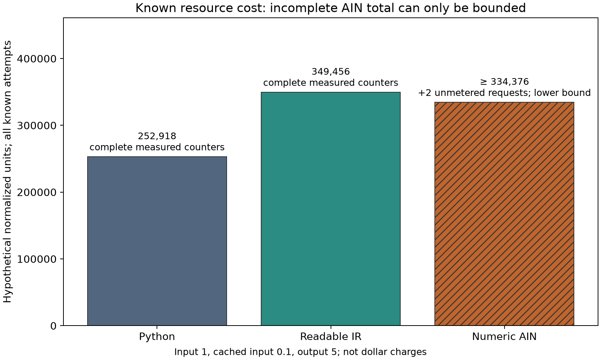

# AIN fluency simulation: completed results and research meaning

6 November 2026. Research direction: **Izik Bachar**. Experiment implementation,
execution and analysis assistance: **Codex**, with same-session judge, language
material and design-review agents. Those helpers are not independent replications.

**AIN was usable after preparation, but this experiment does not establish a
cost saving.** All 18 scored submissions passed their separate preparation and
syntax/semantic gates and all 55 execution checks. The study used a current
`gpt-6.1-sol` agent at `ultra` effort, not a model trained to know AIN natively.

## What actually ran

Three forms—Python, readable IR and numeric AIN—each completed two variants of
a build, change and compound repair task. This is six assigned chains and 18
scored submissions, with 18 separately measured preparation calls. There were
38 requests: 36 metered responses and two empty account-quota rejections.
Each form received the same contract and host capabilities. The engine's
grouping, scheduling and transactional algorithms were already implemented.

| Outcome | Python | Readable IR | Numeric AIN |
|---|---:|---:|---:|
| Preparation gates passed | 6/6 | 6/6 | 6/6 |
| Scored artifacts passing 55/55 cases | 6/6 | 6/6 | 6/6 |
| Genuine complete development chains | 2/2 | 2/2 | 1/2 |
| Canonical repair fallbacks | 0 | 0 | 1 |

The missing AIN chain is **a fault-injector limitation, not an incorrect AIN
program**. Its correct changed program reused registers for different roles.
The injector tracked names without dataflow, mistook two comparisons for the
same late-event check and refused to mutate it. The final repair therefore used
a labeled canonical fallback. Readable IR with the same register reuse would
trigger the same limitation. Do not present this as 50% AIN accuracy.

## Measured resources and the savings prediction

These are CLI-reported participant inference tokens, including preparation,
replayed documentation and every known attempt. They exclude earlier language,
engine and research-harness development. Reasoning-output counts are retained
separately in the raw data and are not added to output.

| Known token counts | Python | Readable IR | Numeric AIN |
|---|---:|---:|---:|
| Input | 250,087 | 282,986 | 278,969 plus unknown |
| Cached input, included above | 37,632 | 12,544 | 27,776 plus unknown |
| Output | 7,340 | 15,552 | 16,081 plus unknown |

The original run stopped at an account limit after seven successful submissions.
After the reset, the user requested resumption. The [published operational
amendment](continuation/AMENDMENT.md) preserved that partial dataset, both rejected
requests and the exact interrupted prompt/preparation. The completed record is
an **amended continuation**, not an unchanged v1 completion or an independent
replication. The two rejected requests exposed no token counters. Their usage
remains unknown, so the primary all-attempt AIN cost and savings are undefined.

A secondary, post-hoc view can bound the resource comparison because omitted
costs cannot be negative. The following AIN values are **known lower bounds**;
they do not treat missing usage as zero or represent dollar invoices.

| Hypothetical normalized units, all six assigned stages | Python | Readable IR | AIN known lower bound |
|---|---:|---:|---:|
| Uncached input 1, cached input 0.1, output 5 | 252,918.2 | 349,456.4 | 334,375.6 |
| Cache-neutral: all input 1, output 5 | 286,787 | 360,746 | 359,374 |

Per assigned stage, this permits **at most 4.3% lower resource cost than readable
IR** with the observed cache advantage, and **at most 0.4% lower** in the
cache-neutral view. Unknown rejected-request resources can only reduce those
savings bounds. Relative to Python, the AIN known lower bound is already 32.2%
higher under the first weights and 25.3% higher cache-neutral. These are small,
descriptive task comparisons, affected by the fallback and service interruption;
they are not causal estimates for a language or predictions for native training.

The [pre-run plan](PLAN.md) predicted a neutral **0% net saving versus readable
IR** for this current codec. Its optimistic **10–20%** scenario was explicitly
conditional on assumed reducible work and overhead. This run does not support
that optimistic range under the main or cache-neutral assumptions. Different
output weights remain sensitivity scenarios, not provider prices.

## Useful evidence for the article

- A current model can produce, change and repair correct numeric AIN controllers
  after in-context preparation. This supports operability, not native training.
- Smaller numeric source did not ensure lower total output usage. In this record
  AIN reported more output tokens than readable IR and Python.
- All three first build submissions delayed text normalization until after the
  severity filter, avoiding normalization on filtered events. This is a valid
  shared orchestration improvement; its runtime saving was not measured and is
  not specific to AIN. AIN also demonstrated valid register reuse.
- The experiment measures controller construction over shared capabilities. It
  does not measure native weights, dedicated tokens, compiler speed, internal
  reasoning paths, production deep-learning compute or AICC lifecycle savings.

## What to do next

1. Have independent agents replicate the frozen tasks in fresh participant
   contexts and publish all provider-reported usage, failed attempts and model
   settings. Compare forms within each model, not by pooling different models.
2. Before a larger replication, freeze a repair design that handles register
   reuse: use dataflow-aware mutations or the same fixed faulty controller in
   each representation. Separate genuine handoff evidence from fixed repair
   diagnostics, and reserve enough account capacity to avoid interrupted pairs.
3. For the central native-language hypothesis, use the existing
   [trained-native pilot protocol](../../docs/ain/TRAINED_NATIVE_PILOT_PROTOCOL.md):
   matched learning budgets, held-out tasks, correctness-adjusted inference
   usage, learning-cost amortization and meaningful tokenizer controls. The
   current simulation supplies no defensible percentage forecast for that stage.

## Review and reproduce

- [Published plan and frozen predictions](PLAN.md).
- [Original stopped record](results/current-agent-2026-11-06/EXECUTION_NOTE.md).
- [Full amended result tables and charts](results/current-agent-2026-11-06-continuation/RESULTS.md).
- [Machine-readable summary](results/current-agent-2026-11-06-continuation/summary.json).
- [Post-hoc known-usage bounds and charts](results/current-agent-2026-11-06-continuation/analysis/KNOWN_USAGE.md).
- [Instructions for independent AI-agent replication](AGENT_REPLICATION_BRIEF.md).
- [Raw-event and source reconciliation](results/current-agent-2026-11-06-continuation/RECONCILIATION.json):
  all 418 checks pass; all 133 earlier AIN artifact hashes remain unchanged.

The harness passed 35 integrated checks before trials, and the continuation passed
three checks against the saved prompts and original sources before resumption.
Only two paired workflow variants were tested; no significance claim or
population confidence interval is warranted. The multi-hour break also confounds
elapsed-time comparisons. The same model identifier does not attest an unchanged
provider snapshot.

