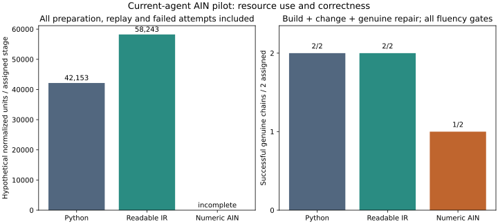
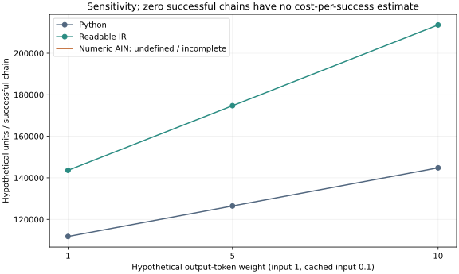

# AIN current-agent fluency pilot: measured results

This measures in-context preparation and controller development by a current agent. It does not test a model trained to know AIN natively. There are only two paired workflow variants per form; these are descriptive results, not population evidence.

Requested model: `gpt-6.1-sol`; effort: `ultra`. Requested identity is not independent snapshot attestation.
Published plan: `82405a53f1ea92b0992b657323617fecb3b3dfaf`. Harness: `3e3a57b267e9bb6b0a936cc021d6e41e58482158`.

## Correctness and denominators

A primary chain needs all three stages, all preparation/fluency gates, hidden correctness, no participant tools, and a genuine predecessor-derived repair. Fallback repairs are diagnostics.

| Form | Stages observed / assigned | Preparation passes | Functional passes | Full stage passes | Successful chains / assigned | Fallback stages |
|---|---:|---:|---:|---:|---:|---:|
| Python | 6/6 | 6/6 | 6/6 | 6/6 | 2/2 | 0 |
| Readable IR | 6/6 | 6/6 | 6/6 | 6/6 | 2/2 | 0 |
| Numeric AIN | 6/6 | 6/6 | 6/6 | 6/6 | 1/2 | 1 |

## All-attempt resource accounting

Every recorded preparation and task attempt is included, including retries, failures, timeouts and fallback work. Cached input is part of input. Reasoning output is displayed separately and is not added to output. Missing counters stay unknown; known subtotals remain available in summary.json but are not represented as complete totals.

| Form | Prep / task attempts | Input | Cached input | Output | Reasoning output (not additive) | Seconds | Timeouts |
|---|---:|---:|---:|---:|---:|---:|---:|
| Python | 6 / 6 | 250,087 | 37,632 | 7,340 | 3,774 | 227.8 | 0 |
| Readable IR | 6 / 6 | 282,986 | 12,544 | 15,552 | 6,444 | 380.3 | 0 |
| Numeric AIN | 6 / 8 | undefined / incomplete | undefined / incomplete | undefined / incomplete | undefined / incomplete | 416.3 | 0 |

Preparation is measured separately below; its transcript is also replayed in the task call and that replay belongs to task input. Both call types remain in all totals.

| Form | Preparation input / output | Task input / output | Preparation primary units | Task primary units |
|---|---:|---:|---:|---:|
| Python | 123,520 / 816 | 126,567 / 6,524 | 116,310.4 | 136,607.8 |
| Readable IR | 138,178 / 808 | 144,808 / 14,744 | 142,218.0 | 207,238.4 |
| Numeric AIN | 135,978 / 918 | undefined / incomplete / undefined / incomplete | 115,569.6 | undefined / incomplete |

## Hypothetical cost sensitivity

These are normalized resource units, **not dollar charges or realized savings**. Primary weights are uncached input 1, cached input 0.1 and output 5. Cache-neutral uses all input at 1 and output at 5. Other output weights are sensitivity assumptions. Elapsed time includes service variability and does not measure compiler speed or isolated model compute.

| Form | Total primary units | Units / assigned stage | Units / successful chain | Cache-neutral units / successful chain |
|---|---:|---:|---:|---:|
| Python | 252,918.2 | 42,153.0 | 126,459.1 | 143,393.5 |
| Readable IR | 349,456.4 | 58,242.7 | 174,728.2 | 180,373.0 |
| Numeric AIN | undefined / incomplete | undefined / incomplete | undefined / incomplete | undefined / incomplete |

AIN saving per successful chain is `1 - (AIN total / AIN successes) / (baseline total / baseline successes)`. Zero successful chains gives an undefined estimate, never zero cost.

| Baseline | Primary AIN saving | Cache-neutral | Output weight 1 | Output weight 10 |
|---|---:|---:|---:|---:|
| Python | undefined / incomplete | undefined / incomplete | undefined / incomplete | undefined / incomplete |
| Readable IR | undefined / incomplete | undefined / incomplete | undefined / incomplete | undefined / incomplete |

The frozen neutral prediction was 0% net saving versus readable IR; the optimistic 10–20% scenarios were conditional assumptions, not confidence intervals. These observations do not estimate native-training savings or prove an internal reasoning mechanism.

## Handoff and judge limitations

- `d75-repair-ain`: canonical fallback: no genuine primary-chain repair.
- `d75-repair-ain`: no verified genuine handoff.

## Stage inventory

| ID | Preparation | Fluency | Hidden correctness | Full stage | Genuine handoff | Fallback |
|---|---|---|---|---|---|---|
| `d30-build-ain` | pass | pass | pass | pass | yes | no |
| `d30-build-ir` | pass | pass | pass | pass | yes | no |
| `d30-build-python` | pass | pass | pass | pass | yes | no |
| `d30-change-ain` | pass | pass | pass | pass | yes | no |
| `d30-change-ir` | pass | pass | pass | pass | yes | no |
| `d30-change-python` | pass | pass | pass | pass | yes | no |
| `d30-repair-ain` | pass | pass | pass | pass | yes | no |
| `d30-repair-ir` | pass | pass | pass | pass | yes | no |
| `d30-repair-python` | pass | pass | pass | pass | yes | no |
| `d75-build-ain` | pass | pass | pass | pass | yes | no |
| `d75-build-ir` | pass | pass | pass | pass | yes | no |
| `d75-build-python` | pass | pass | pass | pass | yes | no |
| `d75-change-ain` | pass | pass | pass | pass | yes | no |
| `d75-change-ir` | pass | pass | pass | pass | yes | no |
| `d75-change-python` | pass | pass | pass | pass | yes | no |
| `d75-repair-ain` | pass | pass | pass | pass | no | yes |
| `d75-repair-ir` | pass | pass | pass | pass | yes | no |
| `d75-repair-python` | pass | pass | pass | pass | yes | no |

Raw stage records, exact responses, usage events and source artifacts accompany this report. Inspect ambiguous judge errors and unsupported mutation cases before attributing failure to a model. No significance test or population confidence interval is justified.
