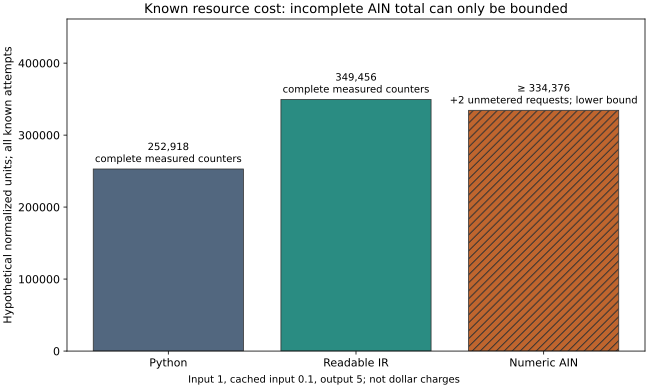
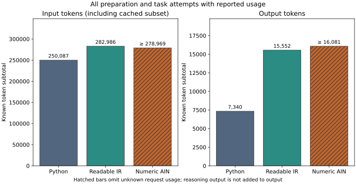

# Known usage and bounds: post-hoc descriptive analysis

This is a secondary analysis of the completed amended continuation. The original primary report stays intact. Its all-attempt AIN cost and exact savings remain undefined where request usage is missing. Known calls provide useful measurements without turning unknown counters into zero.

AIN has 2 wholly unmetered request(s). All known preparation and task attempts, including any metered failures, are included. Original copied observations are counted once; this continuation is not a replication.

| Form | Attempts | Unmetered requests | Known input | Known cached input | Known output |
|---|---:|---:|---:|---:|---:|
| Python | 12 | 0 | 250,087 | 37,632 | 7,340 |
| Readable IR | 12 | 0 | 282,986 | 12,544 | 15,552 |
| Numeric AIN | 14 | 2 | 278,969 | 27,776 | 16,081 |

Correctness and primary-chain eligibility are separate outcomes. A canonical fallback caused by an unsupported mutation layout is a harness limitation; it does not establish an incorrect model submission. The primary chain rule still excludes such a chain.

| Form | Hidden functional stage passes / 6 | Full stage passes / 6 | Genuine primary chains / 2 | Fallback stages |
|---|---:|---:|---:|---:|
| Python | 6/6 | 6/6 | 2/2 | 0 |
| Readable IR | 6/6 | 6/6 | 2/2 | 0 |
| Numeric AIN | 6/6 | 6/6 | 1/2 | 1 |

Input includes its cached subset. Output and reasoning-output counters are preserved separately; reasoning is not added to output. Token counts with missing requests are known subtotals, not complete totals.

## Cost lower bounds

All weights below are hypothetical normalized resource units, not invoices or dollar savings. The primary weights are uncached input 1, cached input 0.1 and output 5. Cache-neutral uses all input at 1; the output sensitivity rows use cached input 0.1.

| Weights | Python exact total | Readable IR exact total | AIN known metered subtotal | AIN cost lower bound | AIN exact total |
|---|---:|---:|---:|---:|---:|
| primary | 252,918.2 | 349,456.4 | 334,375.6 | ≥ 334,375.6 | undefined |
| cache_neutral | 286,787.0 | 360,746.0 | 359,374.0 | ≥ 359,374.0 | undefined |
| output_1 | 223,558.2 | 287,248.4 | 270,051.6 | ≥ 270,051.6 | undefined |
| output_10 | 289,618.2 | 427,216.4 | 414,780.6 | ≥ 414,780.6 | undefined |

The lower bound assumes omitted costs are nonnegative. It says actual AIN resource cost cannot be below the shown amount; it may be higher. With only wholly missing records, the known metered subtotal and lower bound coincide. Partial category records use conservative bounds that respect cached input being a subset of input.

## Resource-saving upper bounds per assigned stage

For a baseline with complete cost, `1 - (AIN cost lower bound / 6 assigned stages) / (baseline exact cost / 6 assigned stages)` is an upper bound on hypothetical resource saving per assigned stage. This descriptive comparison includes every assigned stage and is **not the success-adjusted primary savings outcome**. A positive bound does not show that any saving occurred. A negative bound rules out positive saving under those weights and denominators.

| Baseline | Primary upper bound | Cache-neutral upper bound | Output weight 1 | Output weight 10 |
|---|---:|---:|---:|---:|
| Python | ≤ -32.2% | ≤ -25.3% | ≤ -20.8% | ≤ -43.2% |
| Readable IR | ≤ +4.3% | ≤ +0.4% | ≤ +6.0% | ≤ +2.9% |

The JSON also retains the mathematical upper bound per eligible primary chain. That bound is undefined with zero successful chains. Primary-chain eligibility includes a predecessor-mutation requirement, so a harness-induced fallback can change its denominator even with correct model code. It should not be read as a pure model-cost penalty.

For the article: this pilot can demonstrate whether a current agent can build, change and repair a substantial controller in AIN after supplied preparation, and can describe the resources of recorded calls. Missing measurements prevent an exact all-attempt saving claim. The experiment does not train AIN into model weights or measure a native-language reasoning mechanism.

## Limits

- Missing request usage stays unknown; a known subtotal is not an all-attempt point estimate.
- Bounds assume all omitted resource costs are nonnegative and cached input is a subset of input.
- A positive savings upper bound does not establish any saving; actual saving may be lower or negative.
- These are hypothetical token weights, not invoices or realized dollar savings.
- The resumed dataset reuses original observations and includes a multi-hour service break.
- A fallback can make a primary chain ineligible because of mutator support, even when every model submission is correct.
- Only two paired workflow variants per form; no significance claim or native-training conclusion.
