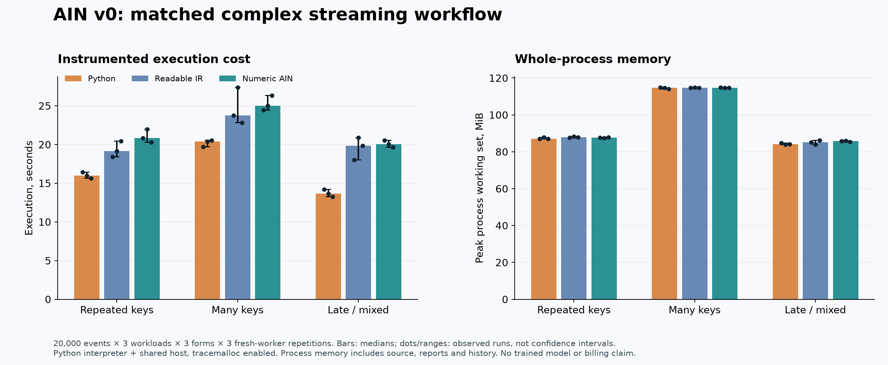
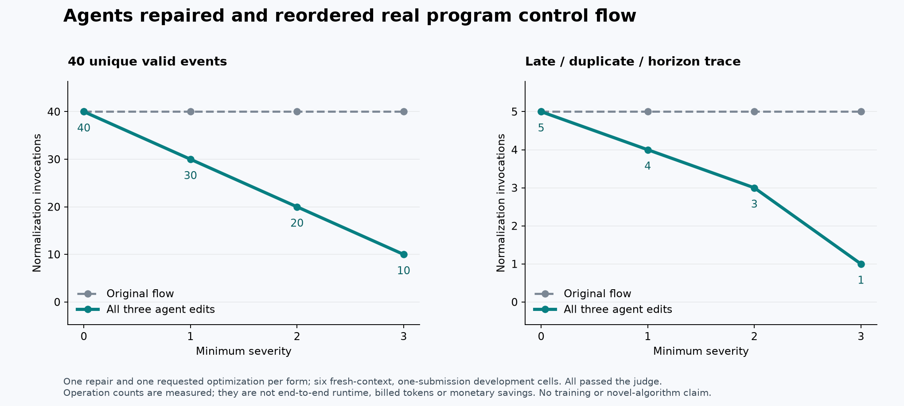

# AIN v0: first execution report

5 November 2026 · development evidence · Izik Bachar's research direction

**AIN v0 can execute, be repaired and be edited on the complex streaming task.
This run does not demonstrate an AIN efficiency advantage.** All 69 engineering
tests pass. All 27 planned processing workers complete with matching canonical
reports, counters, checkpoints and committed-state traces. Six fresh-context
agent submissions—one repair and one requested optimization in each form—pass
their frozen judge on the first submission.

Numeric AIN is slower than direct Python in this implementation: its workload
execution medians are 22.5%–46.5% higher. No billed-token,
financial, energy or training saving was measured.

## What was built

Three executable forms share identical semantic services: direct Python, readable
typed register IR, and numeric AIN v0. AIN and the mechanical symbolic-spelling
control coincide; they are not independent architectures. The typed VM checks
syntax, types, control targets and initialization before effects; it rejects
duplicate JSON keys and nonfinite values, uses exact integer arithmetic and
bounds executed VM instructions with fuel. Trusted host calls are not preempted.

The programs express record admission, late/dedupe/filter branches, loops over
buffered records, and policy/commit sequencing. The same 23 host operations
provide normalization, anchored grouping, real bounded asynchronous fixture
policy calls, authority checks, and an atomic in-memory reference sink. This
shared boundary avoids a one-call whole-workflow program but limits independent
semantic comparisons. This is not a complete general-purpose compiler or a
hostile-code sandbox. The small arithmetic-loop example also executes in both
IR/AIN forms outside the streaming host.

## Correctness evidence

The recorded [conformance log](results/conformance-001.log) contains 69 passing
test methods: 42 workflow, 25 standalone language and 2 generated-check methods.
The workflow tests use handwritten expected groups, counters and commits, not
only agreement between implementations. They cover the published ten-record
trace, Unicode 15.0.0 and the explicit whitespace set, frontier/window boundaries,
finite-horizon dedupe, all four state/report capacities, signed-result overflow,
reverse policy completion, lowest-index policy error, tenant/version authority,
caller cancellation, fencing, idempotent retry, rollback, lost acknowledgment,
append-only recovery and invalid checkpoint/configuration cases.

The generated method compares all forms on 80 seeded streams with 80 arrivals
plus end markers, including out-of-order events, watermarks, duplicate IDs,
normalization and severity variation. Another method rejects five malformed
severity cases even on late-discard candidates. These are public development
cases, not independent hidden model-generalization tasks. Infrastructure tests
repeated by a candidate judge are not additional independent authoring successes.

The sink is in-memory. Fault hooks simulate before-commit and after-commit/lost-
ack boundaries; they do not prove disk durability, distributed transactions or
production secret isolation. Growing input/output history and snapshot copies
remain in process memory. Bounds on active state are not constant total storage.

## Local processing measurements

Python 3.12.14 / Unicode 15.0.0 on Windows, 12 logical processors. Three seeded
20,000-event workloads, three forms, three fresh workers per cell: **27 workers**
and 540,000 event visits over three reused inputs. These are not 27 independent
datasets. Worker order is seeded and shuffled. No model endpoint runs in this
processing benchmark; policy is a deterministic local fixture.

| Workload | Form | Execution median (s) | Fresh worker median (s) | Peak process median (MiB) |
|---|---|---:|---:|---:|
| repeated_keys | python | 15.991 | 16.385 | 87.0 |
| repeated_keys | ir | 19.136 | 19.547 | 87.9 |
| repeated_keys | ain | 20.819 | 21.204 | 87.7 |
| many_keys | python | 20.417 | 20.906 | 114.6 |
| many_keys | ir | 23.754 | 24.336 | 114.7 |
| many_keys | ain | 25.013 | 25.520 | 114.7 |
| late_mix | python | 13.676 | 14.014 | 84.1 |
| late_mix | ir | 19.858 | 20.234 | 85.3 |
| late_mix | ain | 20.036 | 20.440 | 85.8 |

Bars show medians; dots and ranges show three observed repetitions, not confidence
intervals. Execution includes host construction and checking inside the run
entry point, with `tracemalloc` enabled. Full worker time additionally includes
imports, input generation, program preparation, diagnostic preflight checking,
result hashing and process overhead. IR/AIN receive additional preflight checks;
the exact scope is in [the protocol](DEVELOPMENT_PROTOCOL.md). Peak process memory
includes the copied log, reports, checkpoint copies and retained transaction
history. The observed overhead belongs to this Python VM/host implementation,
not a universal property of native languages.

All worker hashes match within each workload; no completed worker was excluded.
[Raw workers](results/development-002/workers.json),
[environment and frozen source hashes](results/development-002/environment.json),
[validation](results/development-002/validation.json) and descriptive summaries
are retained. The first measurement attempt is also retained under
`results/development-001`: four reporting failures from a Windows process-handle
type bug, followed by an interrupted fifth worker. That run is excluded in full,
not selectively pooled into the corrected run. The corrected driver began a new
source-hashed result set.

## Fresh-context agent editing pilot

Six new collaboration-agent contexts each received one representation, one task,
equal semantic documentation, no judge feedback and one final submission. Form
order was seeded within each task. The source and judge were frozen before
dispatch, and their hashes and unchanged initial artifacts were checked around
each judgment. All six negative-control initial artifacts fail their assigned
task judge; all six returned submissions pass it.

| Task | Python | Readable IR | Numeric AIN |
|---|---|---|---|
| Repair an injected frontier-equality defect | Pass, first submission | Pass, first submission | Pass, first submission |
| Move normalization after severity filtering, preserving admission rules | Pass, first submission | Pass, first submission | Pass, first submission |

The optimization is a requested, familiar flow change, not an independently
discovered algorithm. On 40 unique events, all three edits reduce normalization
calls from 40 to 30/20/10 at minimum severity 1/2/3, with identical durable results.
Mixed late/duplicate/horizon traces additionally verify exactly which accepted
offsets are normalized at all four thresholds. End-to-end optimized runtime was
not measured, so these operation reductions are not presented as total savings.

The agents share a machine and tool environment. The permitted-source rule is
cooperative, not secure isolation; a parent authored the harness and inspected
the edits. Exact provider model identity/version, sampling settings, billed
tokens and cost are unavailable. There is one cell per task/form, no independent
replication, no wall-time ranking, and no inference about which form agents
generally write more reliably. [Instructions, initial programs, submissions,
logs, results and protocol](agent_pilot/) are preserved. Always run each judge
as a fresh CLI process; its in-process monkeypatches are not a reusable API.

## Size is a separate observation

The exported Python program is 1,523 UTF-8
bytes. Canonical compact JSON is 3,410 bytes for IR
and 798 for numeric AIN. The separate codebook
alone is 4,076 bytes, plus grammar, host and task
contracts. Formatting affects file size. [Context-bundle records](agent_pilot/context-bundles.json)
count all permitted source files; actual tool outputs and tokenizer/billing costs
remain unknown. Program bytes cannot establish model-token or economic savings.

## Research decision and next work

The engineering feasibility gate passes for this documented prototype and its
tested cases. The hypothesis that a model benefits from a new native language
remains unresolved; renaming this IR numerically does not establish it.

1. Design a structurally distinct candidate, such as typed effect/state edges
   that reject invalid sequencing; compare it with equally capable conventional
   IR. Keep the present numeric codec as the spelling control.
2. Add independently authored task families and reserve a closed final set.
   Preregister success gates, task count, practical margins and uncertainty
   before evaluating it. Include build/explain/edit/repair/optimize/handoff
   chains, not only localized repairs in a supplied program.
3. Set up a version-pinned model interface with actual calls/tokens/cache/billing
   records and an agreed budget. Then run a larger Phase A comparison. This pilot
   supplies development artifacts; it is not that final comparison.
4. Separately test persistent storage and process-level recovery. Pursue matched
   adaptation or dedicated native tokens only under a new explicit protocol and
   matched conventional controls. No model training was performed in this run.

Implementation, tests and analysis: OpenAI Codex and collaboration agents under
Izik Bachar's concept and research direction. The initial processing studies and
article remain historical evidence; their measurements were not relabeled as AIN.
