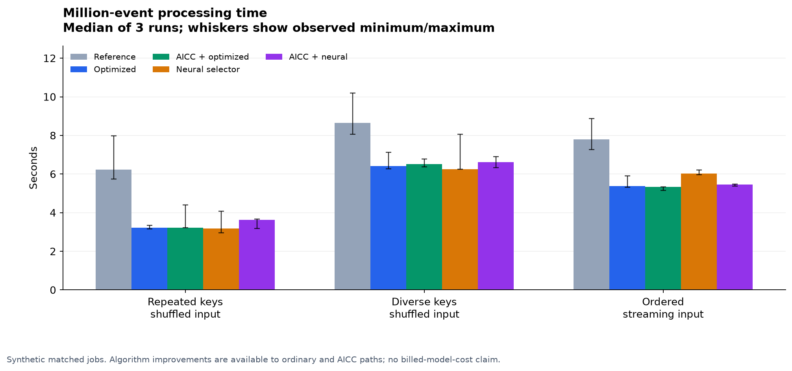
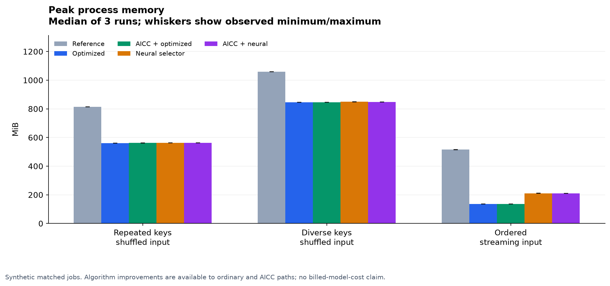
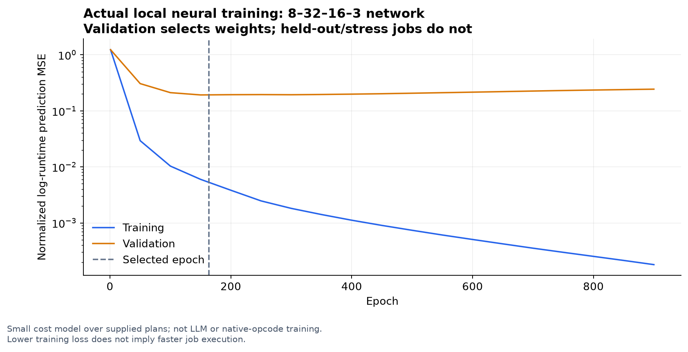

# Interpretation of the 5 November engineering run

The implementation successfully executes equivalent event-processing flows and trains a small neural cost model. It does not establish AICC economic superiority, production security, or a trained AI-native programming language.

## Larger jobs

| Million-event job | Reference seconds | Optimized ordinary seconds | AICC + same optimization seconds | Reference / optimized | Peak memory reduction, reference to ordinary optimized |
|---|---:|---:|---:|---:|---:|
| repeated-shuffled | 6.231 | 3.226 | 3.227 | 1.93x | 31.0% |
| diverse-shuffled | 8.650 | 6.418 | 6.506 | 1.35x | 20.2% |
| ordered-stream | 7.796 | 5.385 | 5.326 | 1.45x | 73.7% |

These improvements arise from agent-designed combinations of caching, filtering, partitioning, and ordered streaming. Every ordinary and AICC path can use them. Registry indirection is not credited for the algorithm improvements.

There were 45 separate executions of million-event jobs, reusing three matched synthetic datasets across five modes and three repetitions. All output summaries and SHA-256 digests matched within each job shape. AICC registration and binding took a median 1.672 ms across the AICC workers.

## Variation and overhead

| Job | Mode | Median seconds | Observed minimum–maximum seconds |
|---|---|---:|---:|
| diverse-shuffled | aicc_learned | 6.609 | 6.328–6.891 |
| diverse-shuffled | aicc_static | 6.506 | 6.366–6.773 |
| diverse-shuffled | learned | 6.256 | 6.248–8.063 |
| diverse-shuffled | reference | 8.650 | 8.058–10.203 |
| diverse-shuffled | static | 6.418 | 6.272–7.123 |
| ordered-stream | aicc_learned | 5.461 | 5.380–5.473 |
| ordered-stream | aicc_static | 5.326 | 5.158–5.343 |
| ordered-stream | learned | 6.028 | 5.959–6.213 |
| ordered-stream | reference | 7.796 | 7.261–8.866 |
| ordered-stream | static | 5.385 | 5.318–5.907 |
| repeated-shuffled | aicc_learned | 3.625 | 3.189–3.664 |
| repeated-shuffled | aicc_static | 3.227 | 3.223–4.406 |
| repeated-shuffled | learned | 3.183 | 2.951–4.081 |
| repeated-shuffled | reference | 6.231 | 5.743–7.988 |
| repeated-shuffled | static | 3.226 | 3.163–3.337 |

These ranges are observations from three runs, not confidence intervals. The host was not exclusive or frequency-pinned. Differences between identical selected kernels across fresh processes include noise and host activity; a small apparent AICC speedup is not evidence that the binding makes the kernel faster. The explicitly timed setup cost is more interpretable than attributing an entire process-to-process difference to the registry. Every worker imports NumPy through the common harness, including the reference/static modes; peak process memory includes that common instrumentation.

## Actual neural learning

The 867-parameter, two-hidden-layer network used 72 training jobs and 24 validation jobs; 24 other jobs were held out. Data collection took 19.60s and neural training took 0.32s. Validation selected epoch 164 of 900 attempted epochs.

On the held-out calibration jobs, selected kernel time totaled 0.4573s versus 0.4531s for the simple policy: the learned choice was 0.94% higher. This estimate excludes selection overhead. The end-to-end stress timings include features and inference.

On the million-event ordered stream, the learned model chose partitioning while the simpler policy chose ordered streaming. The learned ordinary path used more time and memory. The larger jobs are size extrapolation beyond 800–14,000-row calibration, and the model was not retuned on these results. This is an important negative result: adding a neural selector did not consistently improve the strong conventional policy.

## Combining operations into a larger capability

The exploratory warm-call microbenchmark checked 8,096 operation inputs and equal million-value checksums, then measured three randomized repetitions per path.

| Path | Median seconds | Observed min–max seconds |
|---|---:|---:|
| ordinary_split | 0.2707 | 0.2681–0.2848 |
| ordinary_fused | 0.2487 | 0.2267–0.2509 |
| aicc_split | 4.6155 | 4.4567–5.8008 |
| aicc_fused | 2.2867 | 2.2730–2.4950 |
| ordinary_batch | 0.1925 | 0.1882–0.6760 |
| aicc_batch | 0.2036 | 0.1865–0.2278 |

Two AICC calls per value took 4.616s; one AICC call around the entire batch took 0.204s, or 22.7x less elapsed time in this microbenchmark. Ordinary batch execution took 0.193s. Coarse operations avoid repeated host/Python dispatch; ordinary batching benefits too. This is not an inference-token or dollar saving.

The fusion microbenchmark holds authorization/policy fixed. A batch checks its binding on entry, whereas per-event calls check repeatedly. Batching does not establish equal mid-batch revocation, expiry, or cancellation responsiveness; a real contract must permit batch-level checks or specify additional checkpoints. The equality checks here concern mathematical outputs under the fixed policy.

## What this supports

- An AI coding agent can implement and check equivalent alternative flows, then expose the optimized operation through an AICC binding.
- Batch-sized capabilities can keep invocation costs small relative to useful processing; tiny per-event bindings can be expensive.
- Runtime metadata can represent selective invalidation and receiver revalidation in the tested host scenarios. Both runtimes are objects in one Python process. The word "processes" in the raw scenario scope string is a wording error; no fresh OS-process or model/provider handoff was executed.
- Actual local neural training is feasible, but this learned selector does not demonstrate a reliable advantage over the simple policy.

## What remains open

- Full lifecycle economics, billed model tokens, human curation effort, and independent model/provider authoring.
- Real authentication, private execution isolation, complete transitive integrity, and hostile-host security.
- More representative calibration, distribution-shift guards, uncertainty-aware fallback, and fresh evaluation for any revised selector.
- General-purpose AI-native operation-token training and claims of algorithmic novelty.

The appropriate next implementation is a conservative selector that falls back when a job lies outside calibration, followed by new workloads/seeds that have not been used to revise that selector. Keep existing results as the frozen version-one record.

See [the primary report](REPORT.md), [raw worker records](stress-raw.json), [learning record](learning-report.json), [granularity record](granularity.json), and [integrity audit](audit.json).

## Figures

