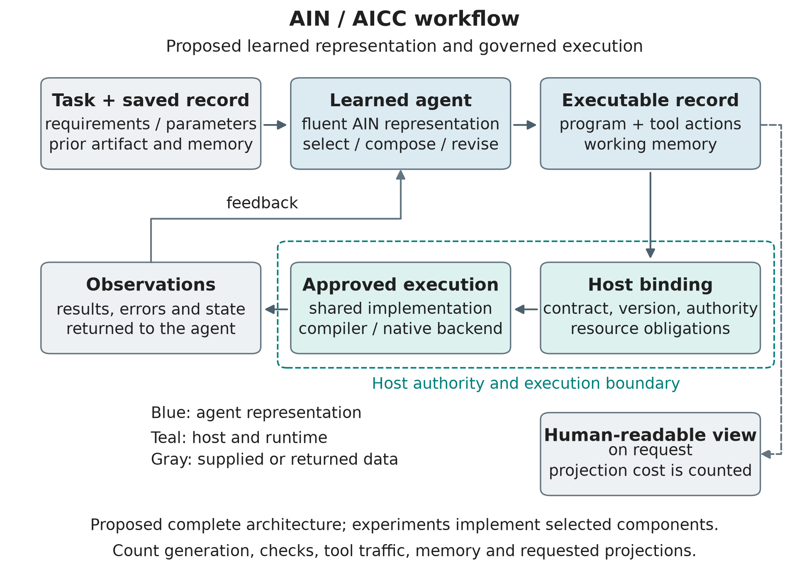
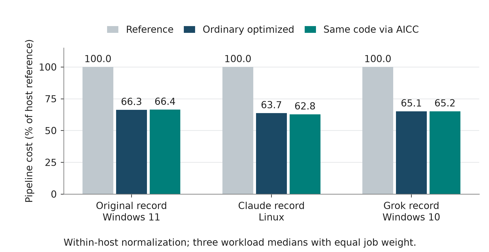
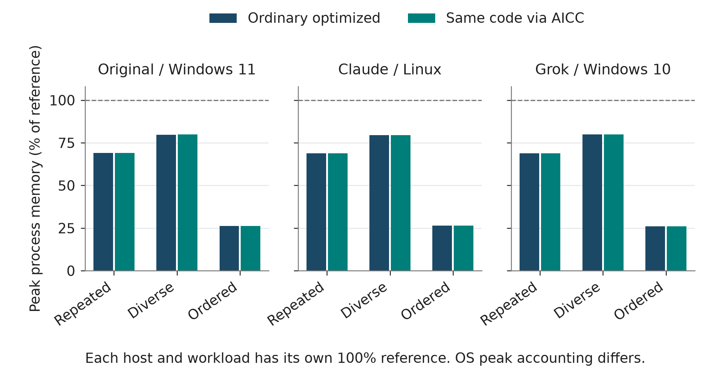
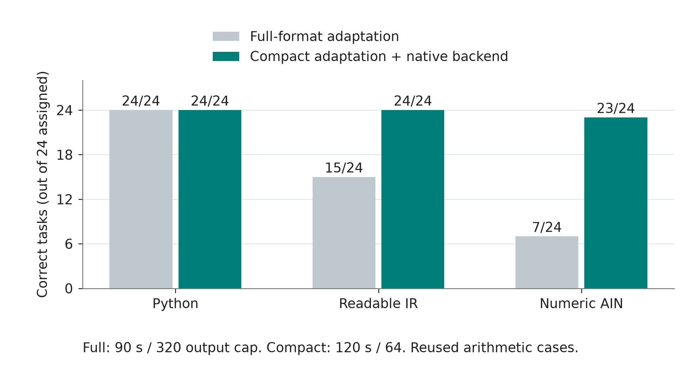
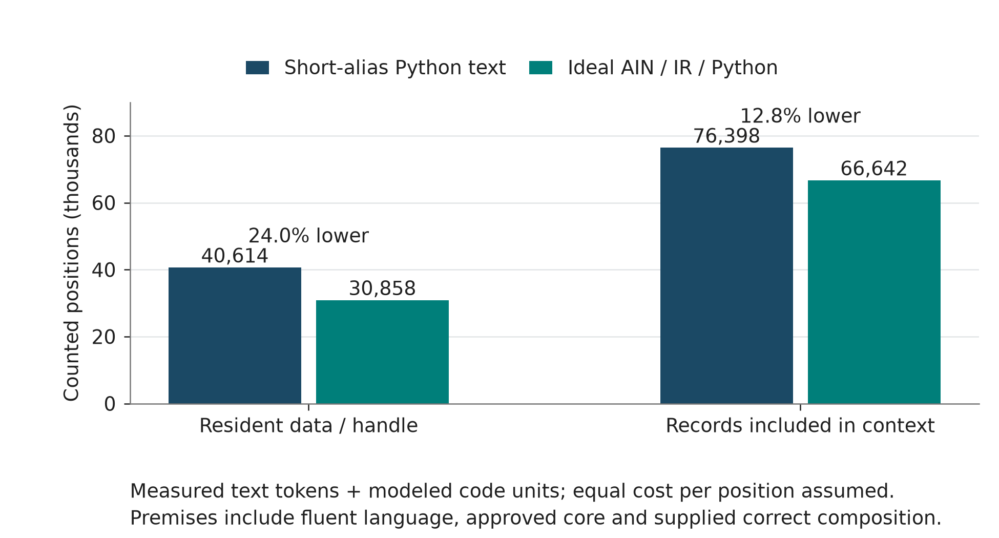

# Giving AI a Language of Its Own

## AIN as a reference concept for native code and shared capabilities

Izik Bachar | Final draft for review | 8 November 2026

### Abstract

AIN, meaning AI Native Language, is the reference name for the theoretical language and compilation approach explored here. The concept gives an AI agent a learned computational vocabulary whose approved operations compile into native machine code and can also form programs, actions and continuing working records. AICC proposes a commons of approved, versioned capabilities that the agent can bind and reuse. This article develops that combined approach through five language examples, final processing measurements, small local model adaptations and a conditional workflow experiment. The workflow calculation yields 24.0% fewer counted positions with resident data and 12.8% fewer with data in context, under fluent-language, approved-core, perfect-composition and equal-unit-cost assumptions. Equivalent ideal Python and IR interfaces tie with AIN. A separate local serialization test preserves fixture behavior across five formats and gives compact Python the lowest observed text-token count. The evidence motivates a research programme that measures learned composition, continuing work, generalization and lifecycle value with strong matched controls. A portable test package accompanies the article. Measured results, illustrative contracts and proposed studies retain separate status.

## Introduction and theory

### It started with a beep

I have spent more than 25 years developing software. The idea came from watching R2D2 beep and plips to other machines and made me realize that communication between machine doesn't need to be set of words a beep can be an entire sentence.

That observation led me to two questions. Could an AI agent learn a precise computational language designed for its own work? Could it compose established functionality through short references while keeping the implementation and its guarantees available underneath?

I use AIN, for AI Native Language, as a reference name for the proposed language concept. The complete language and AI-built compiler described here are conceptual; the repository implements bounded experiments and prototypes. I call the related commons AICC, for AI Computational Commons. AIN concerns the representation an agent uses to author and change computation. AICC concerns discovering, approving, binding and reusing capabilities. Together they suggest a workflow in which an agent works with learned operations, explicit operands, executable records and persistent memory, then produces a human-readable view when requested.

The starting theory grants that an optimized language is already fluent and useful core operations are already approved. A short instruction can therefore invoke substantial computation, including functions, methods and loops. New requirements, arguments, private interfaces and business data still enter the system. The opportunity is to reduce repeated expression and processing of established information while preserving correct work.

The research target is an agent's continuing computational activity. A task may be built, changed, repaired, interrupted and handed to another agent. Its program, tool history and memory can be processed repeatedly. Representation and reuse decisions can therefore affect much more than the length of the first generated answer. A useful evaluation must account for that continuing work and its failures.

This publication selects the final processing records, full-format and compact local adaptations, repaired native compiler measurements, approved-core workflow test and matched local text comparison. Its standalone evidence index links the primary code, raw records, assumptions and independent reconstructions. The article and reproduction instructions require no earlier article draft. [1]

## AIN language meaning and strategy

### Learned operations and explicit meaning

A short operation reference derives its usefulness from a stable behavioral contract. The agent would know the fixed language and established operations before evaluation. A compiler or deterministic runtime would enforce types, effects, resource ownership and control flow. The same representation could appear in generated artifacts, working records, tool actions and memory. Requested source projections and explanations would have their own cost.

The symbolic view uses `@` for a function, `!` for an operation call, `?` for a conditional exit and `^` for a returned value bundle. Indexed slots identify fields or state. Operation contracts determine meaning, ordering and lifetime. For example, an event pipeline must specify whether lateness is checked before reserving a duplicate identifier and whether reservation precedes filtering. Compact notation preserves those obligations. The standalone theory supplies the notation and assumptions in full. [2]

| Notation | Meaning in the illustrated view |
|---|---|
| `@50(c) { ... }` | A function with an ordered parameter list |
| `!501(c)` | A reference to a defined operation with explicit arguments |
| `?(condition):^[value]` | A conditional exit carrying its return value |
| `e[2]` | A field or slot reference defined by the contract |
| `^[r]` | A returned value bundle |

The IDs in the following examples belong to their published example catalog. The notation illustrates the already-available-language premise. Contracts specify materialization, ordering and cleanup. Thirteen deterministic mock scenarios check these declared contracts and failure paths. The source sketches remain illustrations, with no executed C#, C++, Ruby or Java toolchain and no real database, HTTP or OS-thread execution in this example package. [3]

The symbolic notation explains meaning. Each experiment identifies its actual input format and counting rule. A label's character count, its segmentation by a text tokenizer and its ideal learned-code-unit cost are separate quantities. The illustrative application examples supply no measured token-saving claim.

### From a learned reference to native machine code

The intended AIN execution path is native compilation. The agent expresses a computation in its learned representation, and a compiler produces a native executable or native calls into approved implementations. The agent need not first write a Python or C# version. Compiler IR and optimization passes can still exist internally, as in LLVM and MLIR. Here, direct compilation describes the source-to-native execution path; it does not mean that every AIN reference is one processor instruction. [2, 23, 24]

In this concept, AI can help build the language, learn reusable decompositions and construct or optimize the compiler. The starting premise grants that the compiler already knows the approved implementation behind a reference. During a compilation it resolves that known meaning, expands or lowers the required operations, or links an existing native function. Further AI learning can produce an improved version whose contracts and identity are checked before reuse. Relearning a function for every invocation is outside the assumed starting point. [2]

### What !501 means

The reference is like the name of a predefined method. In the database example,

```text
d=!501(config);
```

has the illustrative high-level meaning,

```text
d=ConnectToDB(config);
```

The number 501 is an example-local reference to that approved method and its contract. It is a black box from the caller's perspective because the caller uses its established meaning without rewriting its internal commands. The compiler and implementation catalog retain the information needed to resolve it. A conceptual decomposition could be,

```text
ConnectToDB(config):
    options = ReadConnectionOptions(config)
    handle = AllocateConnection(options)
    OpenDriverConnection(handle, options)
    return OwnedConnection(handle)
```

These are explanatory method steps, not an implemented database frontend. The approved operation also owns failure cleanup and its driver may perform authentication, protocol negotiation and other required work. The compiler can inline suitable steps or emit a native call to a compiled implementation. Driver and operating-system calls remain part of actual execution. [3, 25]

| View | Meaning of the same operation |
|---|---|
| Agent-visible AIN | `!501(config)` references known behavior with an explicit operand |
| Human-readable method | `ConnectToDB(config)` names that behavior conventionally |
| Compiler/catalog view | Approved signature, ownership contract, implementation and dependency version |
| Native executable | Machine instructions and calls to the required native driver/runtime |

The short reference therefore stands for a set of already learned and implemented functionalities. Its implementation has moved into shared compiler/catalog knowledge and approved code. Configuration and task-specific information remain explicit. Operation 502 separately runs the SQL and materializes its rows, and operation 503 releases the connection.

Conventional languages also compile predefined methods. The research question is whether a learned native-oriented representation and reusable computational records reduce the complete work required from an agent under matched capabilities. The repository's compact arithmetic compiler supplies bounded native-execution evidence; database and concurrency expansion remain conceptual examples. The new text comparison tests local serialization and semantic preservation rather than a complete native AIN compiler. [3, 8, 9, 39]

### C# database access

The SQL Server method opens a connection, executes SELECT * FROM Users and materializes the returned table. Command, reader and connection lifetimes follow the using declarations. [25]

C# source

```csharp
using System.Data;
using System.Threading.Tasks;
using Microsoft.Data.SqlClient;
static async Task<DataTable> ReadUsers(string connectionString) {
    await using var db = new SqlConnection(connectionString);
    await db.OpenAsync();
    await using var command = new SqlCommand("SELECT * FROM Users", db);
    await using var reader = await command.ExecuteReaderAsync();
    var rows = new DataTable();
    rows.Load(reader);
    return rows;
}
```

AIN illustration

```text
@50(c) {
  d=!501(c);
  r=!502(d,"SELECT * FROM Users");
  !503(d);
  ^[r];
}
```

Operations 501, 502 and 503 open the configured database, return materialized query rows and close the connection. Configuration is supplied by the caller and the SQL remains explicit task information.

### Python API request

The Python function fetches a caller-supplied HTTPS JSON endpoint with a network timeout and closes the response through its context manager. [26]

Python source

```python
import json
from urllib.request import urlopen

def fetch_users(url):
    with urlopen(url, timeout=10) as response:
        return json.loads(response.read().decode("utf-8"))
```

AIN illustration

```text
@51(u) {
  h=!511(u,10);
  r=!512(h);
  !513(h);
  ^[r];
}
```

Operations 511, 512 and 513 perform GET, materialize UTF-8 JSON and close the response. The URL and timeout remain explicit operands.

### C++ thread management

The C++20 example starts two approved workers, supplies cooperative stop tokens and joins both. Worker bodies handle their own exceptions. [27]

C++ source

```cpp
#include <thread>
#include <stop_token>
void worker1(std::stop_token, int) noexcept;
void worker2(std::stop_token, int) noexcept;
void run_pair() {
    std::jthread a([](std::stop_token s) { worker1(s, 7); });
    std::jthread b([](std::stop_token s) { worker2(s, 9); });
    a.join();
    b.join();
}
```

AIN illustration

```text
@52() {
  a=!521(1,7);
  b=!521(2,9);
  !523(a);
  !523(b);
  ^[];
}
```

Operation 521 starts a worker by its approved reference and argument. Operation 523 joins its owned handle. Worker references 1 and 2 correspond to the two declared source functions.

### Ruby grouped totals

The Ruby function filters paid orders, accumulates exact integer-cent amounts by customer and returns ascending ASCII customer keys. Negative refund amounts retain their arithmetic meaning. [28]

Ruby source

```ruby
def paid_totals(orders)
  totals = Hash.new(0)
  orders.each do |order|
    next unless order[:paid]
    totals[order[:customer]] += order[:amount_cents]
  end
  totals.sort.to_h
end
```

AIN illustration

```text
@53(o) {
  p=!531(o,"paid");
  t=!532(p,"customer","amount_cents");
  r=!533(t);
  ^[r];
}
```

Operations 531, 532 and 533 select a true boolean field, sum integer amounts by key and order the resulting keys. Field names and input records retain explicit representation.

### Java collection pipeline

For nonnull ASCII email values, the Java stream selects active users, projects email strings, removes duplicates and returns sorted results. This ordering contract is consistent across the displayed implementations. [28]

Java source

```java
import java.util.List;
class UserQueries {
    record User(boolean active, String email) {}
    static List<String> activeEmails(List<User> users) {
        return users.stream().filter(User::active)
            .map(User::email).distinct().sorted().toList();
    }
}
```

AIN illustration

```text
@54(u) {
  a=!541(u,"active");
  e=!542(a,"email");
  d=!543(e);
  r=!544(d);
  ^[r];
}
```

Operations 541, 542, 543 and 544 select the active field, project email, remove duplicate values and sort them. The approved result contract specifies an immutable output sequence.

For the resource examples, the assumed native function scope releases owned database and HTTP handles on failure and requests stop/join cleanup for remaining worker handles. These are the lifetime obligations supplied by using declarations, context managers and jthread in the source views. The example package publishes the full operation contracts and the thirteen deterministic mock scenarios used to inspect them. [3]

### An architecture for continuing computational work

The architectural proposal has three connected layers. The agent learns an authoring interface and emits an editable computational record. A host resolves operation references against contracts and current authority. Approved implementations execute the work, returning observations that update the record and memory. A compiler can lower new authorable logic to an execution backend. Each layer has a distinct responsibility and a distinct cost.



Figure 1. Proposed end-to-end workflow. The complete learned system remains a research target. Individual local compilers and capability bindings provide bounded implementation evidence. All exposed operands, observations, memory and requested human views belong in the eventual workflow ledger. [2, 3, 14]

A reusable computational record could carry the current program, references to approved dependencies, task-specific state and the information needed for a later change. An incoming agent could inspect and modify that record through the same learned interface. That design may reduce repeated translation and description, but it also creates obligations for version stability, intelligible error feedback and portable meaning. A smaller artifact that forces more searches or repairs can consume more total work.

The distinction between shared and new information is central. A learned reference can name an established algorithm containing loops without regenerating its implementation. An unfamiliar algorithm, changed business rule or missing capability requires new logic. The programme must test both cases. It should vary library coverage and ask agents to author branches and bounded for/while loops from shared primitives, rather than supplying a whole-task function for every requirement. [14]

### Closest related approaches and the scope of comparison

Toolformer investigates learned API use, ReAct interleaves reasoning and actions, and Code as Policies composes executable policies from established primitives. Closer predecessors also address learned operation references, reusable program libraries and context-efficient execution. The detailed related-work review compares their mechanisms and evidence boundaries. [16-18, 29]

| Related approach | Direct overlap | Distinction required here |
|---|---|---|
| ToolkenGPT and Toolscaler | Learned tool embeddings or compact semantic tool codes | A printed operation ID and a trained semantic token are different interfaces. [30, 31] |
| DreamCoder and LILO | Learned programming abstractions and reusable compressed libraries | This study supplies an approved library; it does not learn the library. [32, 33] |
| Voyager | Persistent executable skills improved through feedback | Saving and reusing capabilities is established prior work. [34] |
| CodeAct | Executable Python as an agent action space with interactive revision | Python receives the same approved functions and state in the local comparison. [35] |
| MCP code execution and Code Mode | Composed calls, controlled intermediate data exposure and ordinary-language execution | Data placement and compact encoding must be compared separately. [36, 37] |
| AI Native Lang, AINL | Its whitepaper describes compact syntax, graph IR, deterministic execution and workflow/memory artifacts | This is a close architectural neighbor with a similar name; its runtime is not run here. [38] |

The linked review also covers Stitch, MemGPT, Coconut, DIAL/RIAL, Byte Latent Transformer, Notation Matters, TSCG and the WebAssembly Component Model/WIT. They help distinguish library learning, memory, latent reasoning, communication, schema encoding and component interfaces from the proposed AIN compilation path. [29]

These sources describe different research systems, implementation patterns and project proposals. No cross-system performance ranking follows from their published numbers. Our local test executes only the encoders, decoders and approved workflow functions supplied in this repository. ToolkenGPT, Toolscaler, DreamCoder, LILO, Voyager, CodeAct, the vendor platforms and AINL are literature/project comparisons, not executed benchmark competitors. [29]

The AIN/AICC question joins representation, persistent computational records and governed capability reuse across a workflow's lifetime. Short references, saved code and host-held intermediate data are already established mechanisms. A distinct AIN structural contribution must be defined and tested against those close neighbors. Compact Python aliases, positional IR, identical libraries, matched information and comparable memory provide important controls. Equal gains across compact learned interfaces would support a shared mechanism.

Compiler infrastructure provides a further separation. LLVM and MLIR show how higher-level representations can be lowered through deterministic transformations to native execution. A compiler may supply predictable scaffolding and eliminate model-generated expansion. Backend optimizations remain available to every language arm. [23, 24]

Inference systems add another measurement boundary. PagedAttention studies KV-cache memory management and serving throughput. Its results illustrate why sequence positions alone cannot determine the cost of a deployed system. The future study must record context reuse, decoding, scheduling and hardware behavior directly, alongside the representation ledger. This is a methodological inference from that systems work. [21]

## Final experiment stages and findings

### What the selected experiments measure

| Final stage | Executed work | Interpretation |
|---|---|---|
| Processing and capability reuse | Three complete 45-worker matrices with common output signatures | Within-host implementation and binding measurements |
| Full-format adaptation baseline | Matched Qwen copies trained and evaluated on bounded arithmetic | Actual narrow learned-format results, including failures |
| Compact source and native execution | Repaired compiler reference checks and matched local adaptation | Scaffolding, common-backend and generation observations |
| Approved-core continuing-work theory | Correct compositions executed through build/change/repair/handoff | Conditional complete-workflow representation demand |
| Matched local serialization | Five decoded local text formats over fixed workflows | Actual tokenizer counts and semantic/state preservation |
| Separate reconstruction and sensitivity | First independent counters and changed-assumption calculations | Reproducibility and boundaries of the fixed calculation |

These stages answer different questions. Processing timings concern supplied executable implementations. The local model screens measure real adaptation and generation on small arithmetic tasks. The workflow theory grants fluency and correct composition to isolate counted demand. The evidence index preserves primary records and qualifications, including repeated datasets, changed evaluation caps, incomplete attempts and contributor provenance. [1]

### Processing flows reproduced across hosts

The processing study compares a reference implementation with optimized cached, partitioned and ordered flows, used through ordinary calls or AICC bindings. Codex's original record and the submitted Claude and Grok remeasurements each contain forty-five complete million-event workers. Together they contain 135 completed worker executions and 135 million event visits on the same three public dataset shapes and seeds. Output signatures agree across the retained records. [4-6]

| Reported record | Host | Ordinary pipeline reduction | AICC pipeline reduction |
|---|---|---|---|
| Codex original | Windows 11 | 33.73% | 33.59% |
| Claude remeasurement | Linux | 36.29% | 37.24% |
| Grok remeasurement | Windows 10 | 34.88% | 34.85% |

Each reduction uses an equal-job mixture of the three per-job medians within the recorded host. Absolute seconds across hosts reflect different environments. These records establish that substantial shared optimizations can remain usable through the binding path. Small direction-varying differences between ordinary and AICC paths have limited resolution with three repetitions on non-exclusive hosts.



Figure 2. Lower pipeline cost within each host reflects shared implementation optimization. Reference cost is normalized to 100 for each record. The figure derives from all three retained forty-five-worker matrices and preserves the ordinary-call control. [4-6]

Peak process memory also improved, with ordinary optimized reductions spanning about 20-74% across the workload/host cells. Ordered streaming avoids retaining the full input list in the measured pipeline. Windows working-set and Linux RSS observations describe their respective processes. [4-6]



Figure 3. Peak process measurements include each process's lifetime high-water behavior. Workloads and repetitions are related cases, and the normalized cells describe within-host changes. The source data retains the absolute MiB medians. [4-6]

An 867-parameter neural selector learned costs among supplied processing plans. On held-out calibration jobs, learned versus simple-policy kernel sums were about 0.4573 versus 0.4531 seconds in the original record, 0.255129 versus 0.255130 in Claude's record, and 0.200323 versus 0.194538 in Grok's. The selector was slightly worse or practically tied. It selected implementations rather than generating a native language. Feature collection and inference belong in the pipeline ledger. [4-6]

Granularity was consequential. The original ordinary batch and AICC batch medians were about 0.193 and 0.204 seconds, while split AICC calls totaled about 4.616 seconds in the invocation microbenchmark. Claude and Grok also observed large split-versus-batch differences. Larger operations amortize dispatch, while cancellation and authority obligations still require an explicit checking policy. The next lifecycle study must measure both together. [4-6]

### Local adaptation and a native compiler screen

Two saved RTX 3080 engineering screens adapted matched copies of Qwen2.5-1.5B. Each arm received ninety-six training examples repeated three times, with one seed, rank-16 LoRA and the existing tokenizer. These are affine arithmetic tasks with reused development and composition cases. The full-format screen required the complete register/type/catalog envelope. The compact screen supplied the same deterministic scaffolding and LLVM backend to every arm. [7, 8, 19, 20]

| Representation | Full-format correct tasks | Compact correct tasks | Compact output tokens | Compact generation seconds |
|---|---|---|---|---|
| Python | 24/24 | 24/24 | 169 | 7.732 |
| Readable IR | 15/24 | 24/24 | 201 | 9.337 |
| Numeric AIN | 7/24 | 23/24 | 201 | 9.164 |

The full-format screen's ninety-second stage cap left some tasks unattempted. Its AIN development score still missed the frozen threshold even if its two development timeouts were granted success. The compact screen used a different output cap, a 120-second stage cap and stronger shared parser constraints. The comparison describes a development change involving representation, constraints and budgets.



Figure 4. The local model observations use one seed and related arithmetic tasks. The two screens use different interfaces and evaluation caps. They provide a diagnostic progression and a within-compact-run control comparison. [7, 8, 19, 20]

The compact compiler emitted and executed native code. All 360 reference programs passed nine input cases each, and equivalent programs from all three forms emitted identical optimized assembly. Full AIN reference targets averaged 102.325 text tokens; compact targets averaged 5.325. Compact readable IR also averaged 5.325, while compact Python averaged 4.525. Predictable scaffolding accounted for the large source reduction. LLVM generated the machine-code expansion through ordinary CPU computation. [8, 9, 23]

These local screens show the feasibility of small adaptation and actual compilation. The user-directed theory question then grants a fluent optimized representation and approved core as premises, allowing a separate examination of complete workflow demand.

### Approved-core whole-workflow theory and agent reconstructions

The approved-core experiment contains eighteen chains across event processing, cache resolution and simulated publication/retry. Each has build, change, repair and fresh-context handoff stages. Every pipeline composes five generic functions. The core contains ten public functions with four explicit for loops, one while loop and seven comprehensions. Build writes a composition, change and repair make one patch, and handoff reuses the saved artifact and memory. All seventy-two stages per schedule execute correctly against the fixture oracles. [10]

The premises grant fluent representation, approved core and perfect composition. A fixed accounting model gives learned references and typed operands explicit costs in a 65,536-entry vocabulary. Fifteen-bit payload units encode new literal information. Python uses measured Qwen text tokens. Common task inputs are charged identically. Combining text tokens and modeled code units assumes equal cost per counted position. There are zero experimental model inference calls in this accounting run. [10]

| Data schedule | Short-alias Python input/output | Ideal input/output | Total reduction |
|---|---|---|---|
| Records behind a host handle | 34,686 / 5,928 | 27,144 / 3,714 | 24.0213% |
| Records included in context | 70,470 / 5,928 | 62,928 / 3,714 | 12.7700% |

Each schedule has 216 logical requests. The two schedules and five representation profiles yield 2,160 deterministic ledger rows. Ideal AIN, ideal readable IR and an ideal Python interface have identical counts under equal encoding opportunities. This demonstrates the conditional mechanism of compact learned composition and repeated-context reuse. Actual inference speed, energy and financial savings require their own conversion and measurement.



Figure 5. The practical columns contain measured Python text tokens plus fixed assumed framing. Ideal columns combine modeled representation units with the same common input and framing. All ideal interfaces tie under equal assumptions. This figure describes conditional position demand. [10]

The resident schedule's difference is 9,756 positions. Reprocessed history, predecessor artifacts and incoming memory account for 7,542, while authored output accounts for 2,214. The same absolute difference produces a smaller percentage when shared business records enter context. That makes the placement and frequency of information central to the whole-agent question.

| Contributor and role | Approved-core reconstruction | Other relevant evidence |
|---|---|---|
| Codex reference implementation | Publishes the target specification and raw ledger | Original processing and local adaptation records |
| Separate Codex counter | First implementation matches all 2,160 rows | Fresh-context reconstruction on the same machine/session |
| Claude submitted counter | First implementation matches all 2,160 rows | Separate processing run and sensitivity extension |
| Grok | Approved-core result pending | Complete forty-five-worker processing submission |

Codex's independent counter was written from the specification and semantic inputs before reference comparison. Claude's raw first ledger also matches exactly. Claude's exact wrapper stopped during tokenizer acquisition. A separately labeled deviation used a hash-verified tokenizer file, passed its checks and matched the reference outputs. Its provenance and earlier AIN exposure remain disclosed. Precomparison seals record the local review order. Contributor identities and remote execution descriptions retain their reported status. [11, 12]

Claude's sensitivity extension reduces the conditional advantage to 21.41% resident and 11.20% inspect when Python memory and observations use compact JSON. Removing the frozen static-symbol vocabulary makes the modeled ideal representation 40.26% and 21.40% larger, respectively. That extreme ablation exposes the importance of useful vocabulary coverage. The extension's 1.619-times break-even boundary applies to representation-dependent unit cost while common text stays fixed. [13]

### Matched local text comparison

A separate CPU-only test compares five local serializations of the same frozen correct workflow traces. It holds approved implementations, task information, operands, data placement, action order and saved state equal. Complete literal request contexts and response strings are tokenized once with the pinned Qwen2.5-1.5B tokenizer, without special tokens or estimated chat framing. Restricted decoders restore the artifacts and actions before execution against the independent fixture oracle. [39]

| Local text profile | Resident total tokens | Inspect total tokens |
|---|---|---|
| Python aliases with repr state | 40,830 | 76,614 |
| Compact Python with compact JSON state | 36,864 | 72,648 |
| Readable positional IR | 40,770 | 76,554 |
| Numeric positional arrays | 39,366 | 75,150 |
| Symbolic AIN call-stream sketch | 43,542 | 79,326 |

All 720 decoded-stage executions matched the fixture outputs, final artifacts, working records and saved memory. All fifty separate literal/state probes and four apparatus regression tests passed. The test contains 2,160 serialized request rows from 144 episodes. Those episodes reuse eighteen chains under the two data schedules. Correct compositions are supplied, and there are zero experimental model calls. These are serialization/semantics checks rather than learned-agent success trials. [39]

Compact Python has the lowest actual text-token count among these fixed profiles. The symbolic sketch uses 18.12% more resident tokens and 9.19% more inspect tokens than that compact control. The symbolic codec covers only the approved-call sketch, not a complete language or an optimized learned vocabulary. Numeric arrays are a separate encoding ablation and do not replace the article's symbolic notation. No format was tuned after observing the outcome. [39]

This actual-text result has a different measurement boundary from the earlier ideal-unit calculation. Its explicit context wrappers, ordinary tokenization and literal representations replace assumed code units and framing. The 24.0% and 12.8% theory reductions remain conditional on their declared learned-unit model. The two experiments must not be presented as measurements in the same unit system. The local test supplies no performance result for the named external systems or a future model fluent in AIN. Its protocol, raw strings, decoded checks and results accompany the portable packet. [10, 15, 39]

### What the combined evidence changes

The processing record establishes that useful optimizations can remain available through a reusable binding path. The native compiler record establishes a bounded compact-source-to-machine-code path shared by all controls. The local learning record shows different outcomes under changed interfaces and limits, with Python remaining competitive. Prior Python familiarity remains a comparison limitation. The approved-core record identifies a conditional opportunity in repeated context and composition while tying all ideal interfaces under equal encoding assumptions.

Together these results justify a focused next study of continuing work. They leave the key empirical link open. A learned agent must choose correct compositions, preserve semantics through changes and handoffs, and finish at lower total measured resources. The next programme makes that link its primary decision rather than treating printed compactness as sufficient evidence. [14]

## AICC shared library and functionality

AICC proposes a governed way to discover an existing capability, establish that it matches the requested contract, bind it under host authority and reuse it. A useful record would identify behavior, version, artifact, declared dependencies, effects, scope and relevant resource guarantees. Public implementation code can run locally on private data, while private policy stays behind an authorized interface.

For the database example, a shared query capability could specify the driver boundary, row materialization, cancellation, resource release and permissions. A host could validate that capability once for a compatible scope, then issue a binding used by multiple agents and programming languages. A new policy, dependency revision or authority change can require revalidation. This is where AICC's proposed lifecycle benefit would be measured.

The processing prototype already demonstrates this pattern with host-managed bindings. Its Python interface obtains a binding under requested obligations and then calls it as a function. AIN could express the same sequence through learned bind and invoke operations. In either representation the SQL, configuration and authority are explicit inputs. The trusted host remains responsible for enforcing the binding's guarantees. [4-6]

The following excerpt uses the existing processing prototype. The factory supplies
the registered implementations, and the caller supplies records and parameters.

```python
host = make_runtime()
binding = host.bind("events.cached@1",
    obligations=("exact-event-groups",),
    requirements={"behavior": "events-v1", "input_order": "any"})
result = binding(records, window, minimum)
handoff_record = binding.export_record()
```

A receiving host can restore that record under its current authority and task
requirements. The example package checks a compatible handoff and an incompatible
receiving requirement. This prototype's checks operate inside a trusted process.
Deployment isolation, authentication and complete dependency integrity require
additional mechanisms. [3, 4-6]

For example, an event-normalization capability and an aggregation capability can be approved separately. An agent composes them for a workflow. Another agent receives the artifact, compatible bindings and persisted state, then changes a threshold or replaces one compatible implementation. Discovery, contract checking, invalidation and any readable review belong in the ledger alongside the short calls.

Operation granularity follows the application's obligations. A batch operation can amortize dispatch across many elements. Cancellation and authority checks may require checkpoints within that batch. The dispatch measurements motivate evaluating granularity together with those checking obligations. Contract tests, versioning and a suitable isolation design must accompany the shared functionality.

## Implementation and the research programme

### A strategic question with several possible answers

AIN and AICC should be pursued as an experimental approach to how agents maintain useful computation. The present theory deliberately starts with fluent optimized representation and approved core. The implementation programme should make those premises observable in a small apparatus, then remove simplifying assumptions one at a time. A large language implementation or public commons is unnecessary before the important decisions can be tested.

Four linked hypotheses guide the programme. A learned representation may reduce complete interaction demand. A persistent computational record may reduce repeated translation, history and handoff work. AIN-specific structure may improve composition or recovery beyond spelling and compact aliases. AICC may reduce repeated discovery, compatibility and revalidation effort. Each hypothesis needs its own matched controls, measurable outcome and credible failure condition.

The full protocol is published with this article. All sample sizes, budgets and decision margins below are proposed design choices. They are not additional results or validated power calculations. [14]

| Phase | Deliverable | Decision before expansion |
|---|---|---|
| Reproduce and stress | Independent ledgers and sensitivity to vocabulary, data placement and reuse | Resolve unexplained discrepancies and publish where the advantage disappears |
| Establish operational fluency | Matched AIN, IR and compact Python agents with the same core and semantics | Every arm passes a frozen fluency gate; adaptation has a separate ledger |
| Measure continuing work | Unseen build/change/repair/handoff chains with actual telemetry | Meet the declared correctness criterion and practical resource margin |
| Test generalization and memory | New control flow, missing capabilities, longer histories and receiving agents | Identify reproducible benefits and failure boundaries across workload strata |
| Measure AICC lifecycle | Ordinary libraries versus governed bindings under identical implementations and checks | Measured recurring savings repay discovery, revision and revalidation costs |
| Replicate and decide | Independent apparatus, second setting and full artifact release | Scale, revise or stop the candidate under the predeclared uncertainty rule |

### The next bounded study

Begin with a feasibility pilot of 24 four-stage chains per arm across event processing, versioned cache rules and asynchronous publication/retry. Each domain contributes four reserved structural templates with two data variants. Training and fluency material use different templates. Start from matched copies of one accessible checkpoint, retaining its unadapted baseline and disclosing its prior Python exposure. The three arms receive identical approved implementations, semantic information, feedback, tool access and decoding constraints.

Run one training seed to check apparatus feasibility, then plan three independently seeded trainings per arm during development. A proposed pilot envelope allows three model attempts per stage, 256 generated positions per attempt and 180 seconds of model-plus-tool time per stage. Measure a small instrumented batch on the available RTX 3080 before freezing the final hardware-hour and memory budget. Revise limits uniformly before evaluation when the apparatus exceeds that budget. A pilot estimates feasibility and variance; its reused cases cannot become an undisclosed final test.

Build creates the program and working record. Change introduces a new requirement. Repair introduces an interacting defect with a bounded feedback policy. Handoff starts a receiving agent without the sender's conversation, using only the declared artifact, memory and capability information. Failures, timeouts and exhausted attempts stay in the assigned denominator. The agent must perform composition itself; correct plans are no longer supplied.

This is an applied adaptation study using the existing pretrained checkpoint. LoRA supplies a practical small-adaptation method, while the Qwen report establishes the checkpoint family's pretrained background. A later matched training study could separate prior-language familiarity more directly. Neither should be presented as a model trained exclusively on AIN. [19, 20]

### Metrics and a decision rule

The primary endpoint is summed elapsed model-and-tool time across all assigned attempts divided by correctly completed chains, accompanied by chain success rate. Fix concurrency and scheduling across arms. Also report complete end-to-end time, GPU time, CPU time, memory, input/output positions, history exposure and tool traffic separately. CPU and GPU seconds retain their own units unless a declared conversion supports a combined score. Learning/setup, generated-program execution and lifecycle maintenance have separate ledgers.

For the later confirmatory design, 72 unseen chains per training seed is a planning starting point. Development variance, task-family dependence and the practical decision margins determine the final sample before opening a reserved final set. A proposed target is at least 10% lower time per correct chain with no more than two percentage points of correctness loss against the strongest matched control. The protocol must justify those margins and use paired uncertainty estimates that respect training seed and task family. A budget that cannot resolve the question yields an inconclusive result.

Proceed when the declared correctness and resource criteria both pass. Reconsider the candidate when correctness fails or measured work is reliably higher. Retain a neutral result when uncertainty spans useful benefit and meaningful harm. A compact Python/IR tie would still identify a valuable shared-interface mechanism. This decision structure gives the project an outcome beyond declaring a language winner.

### Generalization, memory and deployment

The stress programme should vary resident handles, selective tool inspection and full records in context. It should increase history length, memory size and handoff frequency while charging the information actually needed for correct decisions. It should include new public functions, unfamiliar literals, changed signatures, missing capabilities, branches, bounded loops and state transitions from common primitives. Reserve genuinely different control-flow shapes. Vocabulary, serialization and structural constraints need separate ablations.

LiveCodeBench motivates evaluation beyond a single first code generation and addresses contamination and overfitting through broader code-related tasks and evolving problems. Our programme draws a methodological lesson from that work by reserving new structural families and disclosing exposure. It does not claim that these local fixtures have LiveCodeBench's task distribution or contamination guarantees. [22]

After the representation comparison, cross the successful interfaces with ordinary libraries and AICC bindings. Hold function bodies, contracts, caching opportunities and authority checks equal. Measure low-reuse work, dependency revisions, invalidated approvals, stale versions, revoked permissions, incompatible receivers and interrupted work. A transferred record identifies a capability but must not silently transfer authority. Production authentication, isolation and dependency integrity require explicit implementations and tests.

Only after recurring measured savings are positive should the project estimate lifecycle break-even. If additional setup cost is F and measured saving per correct repeated chain is S, F/S gives a conditional reuse threshold in the same units. Observed reuse and revision intervals determine whether that threshold is useful. Training hours, currency and abstract positions require separate calculations.

### Reproducibility as the next deliverable

The [portable final-experiment package](downloads/AICC_Final_Experiments_Packet.zip) and [testing instructions](reproduction/START_HERE.md) accompany this article. The primary route reproduces the frozen approved-core calculation on CPU, with bundled pinned tokenizer assets. A second route reconstructs the counter from contracts and semantic traces before expected-output comparison. Supplementary routes expose final native compiler checks, local adaptation records and processing evidence. GPU retraining requires its separately declared model, dependencies and hardware. [15]

Independent agents should preserve their first implementation and output before comparison. Readers who have already seen this article or expected totals must disclose that exposure. Reproduction of the fixed calculation checks the calculation; an independent learned-agent study on reserved new work supplies the next empirical advance.

The broader opportunity is a stable computational medium shared by authoring, execution, working memory and handoff. Its value would depend on preserving useful semantics while reducing repeated work over time. The plan above turns that possibility into bounded decisions about representation, learning, systems integration and reuse. AIN-specific gains, shared-interface gains, AICC-only lifecycle gains and well-supported negative findings would each guide a different next investment.

## Conclusions

AIN is the reference concept for an AI-oriented computational language with native compilation and learned approved functionality. It proposes that agents use that representation throughout their work. AICC proposes approved, versioned and governable capabilities that support repeated composition and compatibility. The five examples show familiar application behavior expressed through short references with explicit operands and contracts.

The final records establish bounded processing, adaptation, compilation and conditional-accounting results. They support pursuing a continuing-work experiment with actual learned composition and complete resource telemetry. The ideal-interface tie makes strong conventional controls central to that experiment. The full programme adds reserved structures, working memory, handoff, capability coverage and lifecycle costs before a scaling decision.

This article is accompanied by executable evidence, a standalone theory description, a test package and a concrete research protocol. Its next result should show whether the proposed approach preserves correctness on unseen work while reducing the total resources required to maintain and complete it.

## References

1. AICC final evidence index. 2026. Selected final records, metric definitions and contributor provenance. [Evidence](EVIDENCE.md).
2. Bachar, I. 2026. AIN language theory and example contracts. [Standalone theory](AIN_THEORY.md).
3. AICC final source/AIN examples. 2026. Five source pairs, operation catalogs, thirteen mock scenarios and a runnable binding example. [Example package](examples/README.md).
4. Codex processing-study record. 2026. Final source and complete original measurements. [Primary report](../experiments/processing_study/results/full-2026-11-05/REPORT.md).
5. Claude processing remeasurement. 2026. Complete 45-worker run and submitted provenance. [Primary report](../agents/claude/processing-study-replication-2026-11-05/AGENT_REPORT.md).
6. Grok processing remeasurement. 2026. Complete submitted matrix and retained raw results. [Primary records](../experiments/processing_study/results/grok-4.7-2026-11-05-trackA-001/).
7. Codex local full-format adaptation. 2026. Frozen Qwen2.5-1.5B baseline, predictions and all-attempt observations. [Primary report](../experiments/native_learning_gate/results/rtx3080-2026-11-06/REPORT.md).
8. Codex compact native-code adaptation. 2026. Final repaired learning run and predictions. [Primary report](../experiments/ain_compiler_gate/results/rtx3080-2026-11-06-learning-v2/REPORT.md).
9. Codex compact compiler reference. 2026. Repaired reference-v2 source counts, native execution and assembly records. [Primary report](../experiments/ain_compiler_gate/results/rtx3080-2026-11-06-reference-v2/REPORT_REFERENCE.md).
10. AICC approved-core workflow theory. 2026. Frozen specification, correct executable workflows and complete ledger. [Primary report](../experiments/approved_workflow_theory/results/approved-core-2026-11-06/REPORT.md).
11. Codex separate approved-core reconstruction. 2026. First implementation and exact comparison. [Primary report](../experiments/approved_workflow_theory/validation/codex-independent-2026-11-06/INDEPENDENT_REPORT.md).
12. Claude separate approved-core reconstruction. 2026. First counter, acquisition failure and labeled rerun deviation. [Primary report](../experiments/approved_workflow_theory/validation/claude-opus-5.5-independent-2026-11-06/INDEPENDENT_REPORT.md).
13. Claude approved-core sensitivity extension. 2026. Compact JSON, static-vocabulary ablation and unit-cost boundary. [Versioned results](../experiments/approved_workflow_theory/validation/claude-opus-5.5-independent-2026-11-06/extension-v1/sensitivity.json).
14. Bachar, I., with Codex assistance. 2026. AIN and AICC research programme. Proposed protocol and decision gates. [Research plan](RESEARCH_PLAN.md).
15. AICC final-experiment reproduction package. 2026. Exact replay, independent reconstruction, environment pins and integrity checks. [Instructions](reproduction/START_HERE.md), [downloadable ZIP](downloads/AICC_Final_Experiments_Packet.zip).
16. Schick, T., et al. 2023. Toolformer: Language Models Can Teach Themselves to Use Tools. arXiv:2302.04761. [Primary paper](https://arxiv.org/abs/2302.04761).
17. Yao, S., et al. 2023. ReAct: Synergizing Reasoning and Acting in Language Models. arXiv:2210.03629v3. [Primary paper](https://arxiv.org/abs/2210.03629v3).
18. Liang, J., et al. 2023. Code as Policies: Language Model Programs for Embodied Control. arXiv:2209.07753v4. [Primary paper](https://arxiv.org/abs/2209.07753v4).
19. Hu, E. J., et al. 2021. LoRA: Low-Rank Adaptation of Large Language Models. arXiv:2106.09685v2. [Primary paper](https://arxiv.org/abs/2106.09685v2).
20. Qwen Team. 2025. Qwen2.5 Technical Report. arXiv:2412.15115v2. [Primary report](https://arxiv.org/abs/2412.15115v2).
21. Kwon, W., et al. 2023. Efficient Memory Management for Large Language Model Serving with PagedAttention. arXiv:2309.06180. [Primary paper](https://arxiv.org/abs/2309.06180).
22. Jain, N., et al. 2024. LiveCodeBench: Holistic and Contamination Free Evaluation of Large Language Models for Code. arXiv:2403.07974v2. [Primary paper](https://arxiv.org/abs/2403.07974v2).
23. LLVM Project. The LLVM Target-Independent Code Generator. Accessed 8 November 2026. [Official documentation](https://llvm.org/docs/CodeGenerator.html).
24. LLVM Project. MLIR Toy Tutorial, Chapter 6, Lowering to LLVM and CodeGeneration. Accessed 8 November 2026. [Official tutorial](https://mlir.llvm.org/docs/Tutorials/Toy/Ch-6/).
25. Microsoft. Microsoft.Data.SqlClient SqlConnection API, versioned 5.2 view. Accessed 8 November 2026. [Official documentation](https://learn.microsoft.com/en-us/dotnet/api/microsoft.data.sqlclient.sqlconnection?view=sqlclient-dotnet-standard-5.2).
26. Python Software Foundation. Python 3.12 urllib.request. Accessed 8 November 2026. [Official documentation](https://docs.python.org/3.12/library/urllib.request.html).
27. ISO C++ working-draft contributors. Thread support, jthread lifetime and joining. Accessed 8 November 2026. [Primary draft source](https://github.com/cplusplus/draft/blob/main/source/threads.tex).
28. Ruby contributors and Oracle. Ruby 3.3 Enumerable and Java SE 17 Stream API. Accessed 8 November 2026. [Ruby documentation](https://docs.ruby-lang.org/en/3.3/Enumerable.html), [Java documentation](https://docs.oracle.com/en/java/javase/17/docs/api/java.base/java/util/stream/Stream.html).

29. AICC closest-approach review. 2026. Primary literature, project documentation and explicit executed-versus-reviewed boundaries. [Related-work comparison](RELATED_WORK.md).
30. Hao, S., et al. 2023. ToolkenGPT: Augmenting Frozen Language Models with Massive Tools via Tool Embeddings. NeurIPS 2023. arXiv:2305.11554. [Primary paper](https://arxiv.org/abs/2305.11554).
31. Su, Y., et al. 2025. Toolscaler: Scalable Generative Tool Calling via Structure-Aware Semantic Tokenization. Findings of EMNLP 2025. [Primary paper](https://aclanthology.org/2025.findings-emnlp.30/).
32. Ellis, K., et al. 2020. DreamCoder: Growing generalizable, interpretable knowledge with wake-sleep Bayesian program learning. arXiv:2006.08381. [Primary paper](https://arxiv.org/abs/2006.08381).
33. Grand, G., et al. 2024. LILO: Learning Interpretable Libraries by Compressing and Documenting Code. ICLR 2024. arXiv:2310.19791. [Primary paper](https://arxiv.org/abs/2310.19791).
34. Wang, G., et al. 2023. Voyager: An Open-Ended Embodied Agent with Large Language Models. arXiv:2305.16291. [Primary paper](https://arxiv.org/abs/2305.16291).
35. Wang, X., et al. 2024. Executable Code Actions Elicit Better LLM Agents. ICML 2024. arXiv:2402.01030. [Primary paper](https://arxiv.org/abs/2402.01030).
36. Jones, A., and Kelly, C. 2025. Code execution with MCP: Building more efficient agents. Anthropic, 4 November 2025. [Primary engineering article](https://www.anthropic.com/research/code-execution-with-mcp).
37. Varda, K., and Pai, S. 2025. Code Mode: the better way to use MCP. Cloudflare, 26 September 2025. [Primary engineering article](https://blog.cloudflare.com/code-mode/).
38. AI Native Lang project. AI Native Lang (AINL): An AI-Native Programming Language for Deterministic Agent Workflows. Project whitepaper, accessed 8 November 2026. [Project documentation](https://www.ainativelang.com/whitepaper).
39. AICC matched local representation comparison, version 1. 2026. Frozen protocol, actual text-token ledger and decoded semantic/state checks. [Protocol](../experiments/representation_comparison/PROTOCOL.md), [observed report](../experiments/representation_comparison/results/comparison-v1/REPORT.md).

## Credits

Concept, architecture, research direction and final editorial approval belong to Izik Bachar. The opening origin paragraph is preserved as requested. Codex prepared the current synthesis, reference implementations, evidence selection, figures and reproduction tooling with same-session collaboration agents.

The final records retain their individual authorship. Codex produced the original processing record, local adaptation/compiler screens and reference accounting. Separate Codex and Claude implementations reconstructed the accounting. Claude and Grok supplied processing remeasurements, and Claude supplied the sensitivity extension. Contributor model identities and remote environments retain their submitters' self-reported status. Grok's approved-core reconstruction remains pending.

Earlier exploratory discussions included contributions attributed to ChatGPT/OpenAI, Claude/Anthropic, Gemini/Google and Grok/xAI. Those contributions remain acknowledged in the project history. The selected final evidence and its limitations are identified explicitly in this publication. This remains a final draft for editorial review and a proposed research programme.
